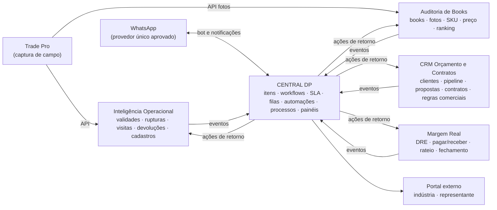
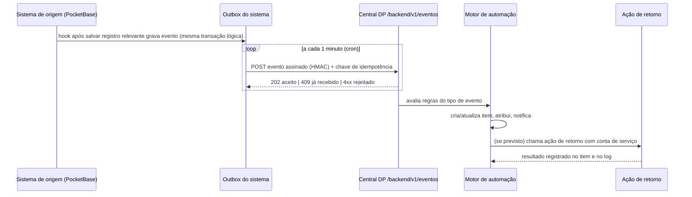

# Escopo Definitivo — Sistema Inteligente de Processos e Gestão Operacional

**Nome de trabalho do produto:** Central DP — gestão de trabalho, processos e automações da Diretoria Promoções (nome provisório)
**Cliente:** DCG Consultoria Merchandising e Promoções Ltda. (Diretoria Promoções)
**Processo master:** Gestão Operacional de Trade Marketing e Merchandising
**Horizonte:** quatro meses, em cinco fases incrementais
**Versão:** 2.1 — 15/10/2026
**Substitui:** versão 1.0 de 18/09/2026 (arquivada em `03-Projeto/_historico/02-Escopo-Definitivo-v1.0.md`)
**Incorpora:** a manifestação da Diretoria de 23/09/2026 sobre a v1.0, exceto a IA por área, que fica fora deste ciclo (seção 14)
**Documentos complementares obrigatórios:** `03-Projeto/03-Analise-Sistemas-Existentes.md` e `03-Projeto/04-Analise-Manifestacao-Diretoria.md`
**Status:** escopo detalhado; aguarda aceite do champion da DCG

---

## 0. Como ler este documento e o que mudou da v1.0

Este documento define **o que será construído, como se conecta aos sistemas que a DCG já possui, em que ordem, e como cada entrega será aceita**. Cada requisito tem um identificador (`RF-`, `RNF-`, `AUT-`, `EV-`, `INT-`, `SEG-`, `D-`) para ser rastreado até SPECs e tasks.

| Tema | v1.0 (18/09) | v2.0 (este documento) |
|---|---|---|
| Natureza do produto | Sistema operacional que centralizaria validade, ruptura, ocorrências, trocas, auditoria e painéis | **Plataforma de gestão de trabalho no estilo Jira**: espaços, itens, workflows, filas, SLA e motor de automações, que **orquestra** os sistemas já existentes |
| Sistemas existentes | Não considerados (só Trade Pro, Excel e WhatsApp) | Cinco sistemas internos mapeados e integrados: Inteligência Operacional, Auditoria de Books, Gestão de Ocorrências, CRM de Orçamento e Contratos e Margem Real |
| Validade, ruptura, devoluções, books | Seriam construídos no novo sistema | **Permanecem nos sistemas que já os implementam**; o hub recebe eventos, cria trabalho, acompanha e cobra |
| Automações | Lista de 8 automações fixas | Motor de regras configurável (gatilho → condição → ação) com catálogo inicial de 30 regras, guardrails e trilha |
| Processos, manuais e treinamento (DMO) | Mencionados de forma indireta | Módulo próprio: base de processos (POPs), manuais de função, matriz de responsabilidade, checklists e trilhas de treinamento ligados ao trabalho |
| Segurança | Critérios gerais | Gate de segurança obrigatório nos sistemas existentes antes de qualquer integração (seção 11) |
| Critérios de aceite | Por fase, em texto corrido | Por fase, no formato Dado/Quando/Então, com demonstração e evidência |
| Pedidos da manifestação de 23/09 (v2.1) | — | Incluídos: central interna com fila explicada da IO; índice de saúde da loja; portal do promotor; ocorrências com conferência, reabertura controlada e encaminhamento seguro à indústria; esteira de publicação com auditoria antes de divulgar; ficha do profissional (RH); campanhas e materiais (marketing); financeiro integrado e jornada do cliente; catálogo de dados; matriz de entregas por fase (Anexo C); casos de demonstração (Anexo D) |
| IA por área (comercial/SDR, orçamento, financeiro, marketing, RH, recomendação de pedido e mix) | — | **Fora deste ciclo** (seção 14); a IA do ciclo continua limitada a classificação de ocorrências, resumo e assistente de procedimentos |

---

## 1. Decisão executiva

1. A DCG terá **um único lugar oficial para o trabalho**: toda pendência, ocorrência, cobrança, aprovação, tarefa de implantação, tarefa financeira, correção de auditoria e melhoria de processo existe como **item de trabalho** na Central DP, com responsável, prazo, prioridade, status, SLA e histórico.
2. **Os sistemas existentes continuam donos dos seus dados de domínio.** A Inteligência Operacional continua dona de validades, rupturas, visitas, devoluções e cadastros operacionais; o Sistema de Auditoria de Books continua dono de books, fotos e classificação de SKUs; o CRM continua dono de clientes, oportunidades, propostas, contratos e regras comerciais; o Margem Real continua dono do financeiro. A Central DP **não duplica** essas regras.
3. A conexão entre sistemas é feita por **eventos**: quando algo relevante acontece em um sistema (ex.: validade ficou crítica, book importado com fotos a revisar, oportunidade ganha, conta vencida), o sistema publica um evento; o **motor de automação** da Central DP transforma o evento em trabalho, atribui, cobra e escala. Quando o trabalho é concluído, a Central DP devolve o resultado ao sistema de origem quando houver ação de retorno definida.
4. **Gestão de Ocorrências deixa de existir em duas versões.** Hoje existe um sistema de ocorrências independente e um módulo de ocorrências copiado dentro do CRM, com evolução divergente. O escopo define a **consolidação das ocorrências como tipo de item nativo da Central DP** (fase 2), preservando as regras já validadas pela operação (seção 9.5). A decisão final é do champion (D-01).
5. **O aplicativo Trade Pro continua sendo a captura de campo.** A Central DP não é aplicativo de promotor; o promotor interage por notificação, link de item, bot de WhatsApp aprovado e, quando necessário, por uma visão simplificada no celular.
6. **Decisão humana permanece humana.** Aprovação de troca, decisão comercial, reprovação de auditoria, desligamento e exceções de regra têm sempre um responsável identificado. A IA sugere, resume e prioriza; não aprova.
7. **Nenhuma integração é ativada antes do Gate de Segurança** (seção 11). A análise dos sistemas encontrou repositórios públicos com credenciais e dados pessoais, rotas sem autenticação e cadastro público aberto. Esses pontos são pré-condição, não melhoria opcional.
8. A Central DP será construída na mesma base tecnológica dos sistemas atuais (Skip: React + TypeScript + Tailwind/shadcn no frontend e PocketBase no backend), para que a DCG mantenha um único padrão de manutenção. O código fica em repositório **privado** da DCG no GitHub.

---

## 2. Contexto e problema

### 2.1 Situação declarada no DMO e nas reuniões

- Maturidade ASA: Amplificar 5,8; Sistematizar 3,1; Automatizar 0,6; nota geral 3,2.
- Gargalo declarado: falta de integração e automação; informação espalhada em planilhas, WhatsApp e sistemas diferentes; processos dependentes de pessoas; dificuldade de acompanhar indicadores em tempo real.
- Objetivo estratégico: estruturar e escalar a Diretoria Promoções como empresa nativa em IA, com processos padronizados, automatizados e orientados por dados, para crescer em Santa Catarina e expandir no Sul.
- Metas de referência do DMO: documentar e padronizar 80% dos processos críticos; 100% das funções principais com responsabilidades e procedimentos definidos; reduzir 40% de problemas e retrabalho recorrentes; reduzir 50% da dependência da diretoria para dúvidas e decisões do dia a dia; reduzir o tempo de treinamento e integração.
- Decisão do kickoff (01/09/2026): primeiro ciclo focado em estruturação operacional, alertas automáticos e gestão à vista; expansão comercial adiada.

### 2.2 Situação observada nos vídeos de processo

- Controles paralelos (Excel, Timeline, WhatsApp, Trello, PDF, PowerPoint) para compensar dado de campo atrasado ou incompleto.
- Pendências cobradas por print em grupo, sem responsável formal, prazo ou registro de encerramento.
- Aprovação de troca por emoji; ocorrências perdidas em mensagens; auditoria de fotos foto a foto.
- Conhecimento de regras (por rede, marca, fornecedor) concentrado em pessoas.

### 2.3 Situação encontrada nos sistemas internos (resumo da análise)

Entre 14/08 e 15/10/2026 a DCG construiu, com o Skip, cinco sistemas próprios que já cobrem boa parte do que a v1.0 previa construir. O detalhamento está em `03-Analise-Sistemas-Existentes.md`. Em resumo:

| Sistema | Já resolve | Lacuna principal para a gestão do trabalho |
|---|---|---|
| Inteligência Operacional | Integração com a API do Trade Pro (rupturas, validades, visitas); criticidade; rupturas; devoluções/NF com auditoria; cadastros mestres; lojas; indústrias e mix; relatórios; alertas | Alertas só na tela (estado de leitura no navegador); tratativas sem responsável/SLA formal; sem notificação ativa |
| Auditoria de Books | Importação de books, análise de SKU por foto (pHash), preço, splash, sortimento, ranking de promotores, integração Trade Pro para fotos | Correções identificadas não viram tarefa acompanhada |
| Gestão de Ocorrências | Ocorrência com IA de classificação, direcionamento por área, SLA, lembretes, escalonamento, autorização de representante, webhooks de WhatsApp | Duplicado dentro do CRM; lembretes não enviados de fato; sem testes |
| CRM de Orçamento e Contratos | Clientes, pipeline, propostas por plano, contratos, apresentações, regras operacionais e tabela comercial versionadas, capacidade operacional, roteirização, WhatsApp (Evolution) e bot de ocorrências | Oportunidade ganha não dispara implantação; módulos fora do domínio comercial (ocorrências, PDV) |
| Margem Real | DRE gerencial, contas a pagar/receber, lançamentos, importação de extrato, rateio por cliente, previsto × realizado, multi-CNPJ | Vencimentos e fechamento não geram tarefas; sem trilha de aprovação |

**Problema central que este escopo resolve:** a DCG já tem dados e regras em sistemas, mas **o trabalho que nasce desses dados continua sem dono, sem prazo e sem fechamento comprovado** — ele ainda circula em WhatsApp, memória e planilha. Além disso, os cinco sistemas não conversam entre si: lojas, promotores e indústrias estão cadastrados até cinco vezes, com chaves diferentes.

---

## 3. Objetivos e indicadores de resultado

Nenhum ganho é declarado sem baseline medido na fase 1 (seção 12) e cálculo registrado.

| ID | Indicador | Definição | Fonte | Baseline | Meta de referência |
|---|---|---|---|---|---|
| IND-01 | Trabalho rastreado | % das pendências operacionais que existem como item com responsável e prazo | Central DP vs. amostra de grupos de WhatsApp/Trello | Medir em F1 (amostra de 2 semanas) | ≥ 90% ao fim da F5 |
| IND-02 | Cumprimento de SLA | % de itens concluídos dentro do SLA, por tipo e área | Central DP | Ocorrências: dados atuais do sistema de ocorrências | Definir após 4 semanas de F2 |
| IND-03 | Tempo até primeira ação | Mediana entre criação e primeira tratativa | Central DP | Ocorrências atuais | Redução a definir |
| IND-04 | Tempo de resolução | Mediana entre criação e conclusão, por tipo | Central DP | Ocorrências atuais; demais tipos medidos em F2/F3 | Redução a definir |
| IND-05 | Recorrência | Nº de itens do mesmo tipo × loja × indústria em 30 dias | Central DP + IO | Rupturas e ocorrências atuais | -40% (meta DMO) após baseline |
| IND-06 | Dependência da diretoria | Nº de itens escalados para diretoria ou em que a diretoria é responsável | Central DP | Medir em F1/F2 | -50% (meta DMO) |
| IND-07 | Processos documentados | % dos processos críticos do inventário com POP publicado e dono | Base de processos | Inventário em F4 | 80% (meta DMO) |
| IND-08 | Funções com responsabilidade definida | % das funções com manual de função publicado | Base de processos | Inventário em F4 | 100% (meta DMO) |
| IND-09 | Automação útil | % de itens criados por automação que foram concluídos sem serem marcados como "ruído/improcedente" | Central DP | Desde a 1ª regra | ≥ 80% |
| IND-10 | Tempo de onboarding | Dias entre admissão do promotor e conclusão da trilha de treinamento | Central DP | Medir em F4 | Redução a definir |
| IND-11 | Saúde da loja | Índice de 0 a 100% por loja (RF-180), com cobertura de dado | Central DP (IO, Books, itens) | Primeira apuração em F4 | Metas por loja/cliente aprovadas pela Diretoria |
| IND-12 | Aderência de tempo | Minutos vendidos × planejados × executados por loja e cliente | CRM + IO | Medir em F3 | Faixa de tolerância aprovada pela Diretoria |

---

## 4. Princípios de produto e arquitetura

1. **Um item, um dono, um prazo.** Todo trabalho tem exatamente um responsável por vez e um prazo calculado.
2. **O sistema de origem é a verdade do dado; a Central DP é a verdade do trabalho.** O item guarda referência e link para o registro de origem, não uma cópia editável.
3. **Evento antes de cópia.** Integração por evento idempotente; consulta direta só para enriquecer ou como contingência.
4. **Automação explícita, versionada e reversível.** Toda regra tem autor, versão, log de execução, modo de simulação e botão de desligar.
5. **Ruído é defeito.** Regras agrupam eventos (ex.: um item por loja × indústria × dia) e têm limites de volume; item marcado como ruído alimenta revisão da regra.
6. **Falha não vira "conforme".** Ausência de dado, timeout ou erro de integração geram item de incidente, nunca um status positivo.
7. **Fechado não reabre em silêncio.** Item concluído só é reaberto por transição explícita com motivo; ocorrência fechada não muda de status (regra já validada) — gera novo item vinculado.
8. **WhatsApp é canal, não registro.** Notificação e captura podem passar pelo WhatsApp; status, aprovação e histórico vivem na Central DP ou no sistema de origem.
9. **Processo antes de automação (ASA).** Cada tipo de item aponta para o POP que o orienta; automação só é ligada para processo com POP publicado e dono.
10. **Configuração pela interface.** Workflows, campos, SLAs, filas, matriz de responsabilidade, calendários e regras são configuráveis por administrador sem código, dentro dos limites do RF.

---

## 5. Ecossistema e papel de cada sistema



| Sistema | Papel no ecossistema | Dono de | Envia à Central DP | Recebe da Central DP |
|---|---|---|---|---|
| **Central DP** (novo) | Sistema de registro do trabalho, dos processos e das automações | Itens, workflows, SLA, filas, regras, POPs, manuais, treinamentos, registro mestre de correspondência | — | — |
| **Inteligência Operacional** | Sistema de registro da operação de campo e da integração Trade Pro | Validades, rupturas, visitas, devoluções/NF, cadastros operacionais (lojas, redes, promotores, supervisores, indústrias, mix) | Eventos de validade, ruptura, visita, devolução, cadastro, falha de sincronização | Resultado de tratativa, status de auditoria, correção cadastral confirmada |
| **Auditoria de Books** | Sistema de registro da auditoria de execução por foto | Books, fotos, classificações de SKU, regras de auditoria, sortimento, preços, agenda | Book importado, fotos a revisar, SKU ausente/preço divergente/splash ausente, ranking | Status de revisão da foto/correção |
| **Gestão de Ocorrências** (atual) | Absorvido pela Central DP na F2; depois somente leitura | Ocorrências (até a migração) | Eventos de ocorrência até a migração | — |
| **CRM** | Sistema de registro comercial e de dimensionamento | Clientes, oportunidades, propostas, contratos, apresentações, regras operacionais e tabela comercial versionadas, capacidade e alocações | Oportunidade ganha, contrato a vencer, necessidade de contratação, nova versão de regra/tabela, proposta parada | Status da implantação |
| **Margem Real** | Sistema de registro financeiro gerencial | Lançamentos, contas a pagar/receber, DRE, rateio, fechamentos | Contas a vencer/vencidas, fechamento aberto, margem abaixo do mínimo | Conclusão de tarefa de fechamento (opcional) |
| **Trade Pro** | Captura de campo (externo) | Roteiros, visitas, fotos, registros do promotor | Indiretamente, via IO e Books | Nada no ciclo |
| **WhatsApp** | Canal de notificação e captura guiada (bot) | Nada oficial | Mensagens do bot (captura de ocorrência/ponto extra) | Notificações aprovadas |

---

## 6. Usuários, perfis e permissões

### 6.1 Atores

| Ator | Quem (referência atual) | Usa a Central DP para |
|---|---|---|
| Diretoria / Dono | Daniel (CEO), Carol (sócia) | Painel executivo, decisões de alçada, aprovação de regras de automação de alto impacto |
| Gestor de área | Responsáveis pelas áreas da matriz de direcionamento: Inteligência Operacional, Operação de Loja, Merchandising, Pontos Extras, Acesso à Loja, Financeiro, RH, Comercial | Filas da área, SLA, distribuição, indicadores, POPs da área |
| Inteligência Operacional | Equipe de IO (validades, rupturas, trocas, relatórios) | Itens gerados pela IO, pendências cadastrais, incidentes de sincronização |
| Supervisor de campo | Supervisores cadastrados na IO | Fila da equipe, cobrança de promotores, tratativas de loja |
| Promotor | Promotores ativos | Itens atribuídos a ele (visão simplificada no celular), checklists, treinamentos; abertura de ocorrência pelo bot |
| Auditoria / Books | Analistas de books | Fila de revisão e correções de auditoria |
| Comercial | Daniel e equipe comercial | Projetos de implantação, follow-ups, renovações |
| Financeiro / Administrativo | Daniel, Carol | Tarefas financeiras e fechamento mensal (espaço restrito) |
| RH | Responsável por pessoas | Ficha do profissional, documentos, onboarding, desligamento, necessidades de contratação |
| Marketing | Responsável por campanhas e materiais | Campanhas, materiais e instruções por cliente, marca, loja e período |
| Auditoria de publicação | Gabriel e analistas de books | Conferência de evidências e relatórios antes da divulgação à indústria |
| Representante da indústria | Representantes cadastrados | Autorizações e itens com visibilidade "representante" (portal, F5) |
| Cliente / Indústria | Usuários de clientes | Itens e indicadores com visibilidade "indústria" das suas marcas (portal, F5) |
| Administrador da plataforma | Champion (analista de dados) e quem ele designar | Configuração de espaços, workflows, campos, SLAs, regras, integrações e usuários |
| Conta de serviço | Uma por sistema integrado | Publicar eventos e executar ações de retorno, com permissão mínima |

### 6.2 Perfis globais e permissões

| Capacidade | Admin | Diretoria | Gestor de área | Membro interno | Supervisor | Promotor | Representante | Indústria |
|---|---|---|---|---|---|---|---|---|
| Ver itens do espaço | todos | todos | seus espaços | seus espaços | sua equipe | os seus | os liberados | os liberados |
| Criar item | sim | sim | sim | sim | sim | ocorrência, solicitação | comentário/autorização | não (F5: solicitação) |
| Transicionar item | sim | sim | sim | se responsável | sua equipe | os seus, transições permitidas | autorizar/negar | não |
| Atribuir/reatribuir | sim | sim | na área | não | na equipe | não | não | não |
| Editar SLA/prioridade | sim | sim | na área | não | sugerir | não | não | não |
| Criar/editar workflow e campos | sim | não | propor | não | não | não | não | não |
| Criar/editar regra de automação | sim | aprovar alto impacto | propor e simular | não | não | não | não | não |
| Publicar POP/manual | sim | aprovar | sua área | sugerir | sugerir | ler | não | não |
| Ver painel executivo | sim | sim | resumo da área | não | não | não | não | painel do cliente |
| Ver espaço Financeiro | sim | sim | se financeiro | não | não | não | não | não |
| Configurar integrações | sim | não | não | não | não | não | não | não |

### 6.3 Escopo de dados

- Todo item carrega dimensões de escopo quando aplicável: **indústria/cliente, marca, rede, loja, região, supervisor, promotor, área**.
- Perfis externos (representante, indústria) e promotor só enxergam itens dentro do seu escopo **e** com visibilidade compatível (`interno`, `representante`, `industria` — valores já usados no sistema de ocorrências).
- O escopo é aplicado **no backend** (regras de API do PocketBase e filtros nos endpoints), nunca somente na tela. Requisito testado por perfil em toda fase (RNF-SEG-03).
- Campos sensíveis (valores financeiros, dados pessoais de promotores) só aparecem para perfis autorizados; exportações respeitam o mesmo filtro.
- **Permissões adicionais da v2.1:**
  - **dado salarial** e custo individual de equipe: só Diretoria e Financeiro com permissão específica "ver salários", separada do acesso ao espaço FIN;
  - **ficha do profissional**: RH completo; gestor direto vê situação, treinamentos e documentos vencendo, sem dados salariais nem documentos pessoais;
  - **separação de CNPJs**: perfis financeiros podem ser limitados ao Grupo Diretoria Promoções, à DCG ou a ambos;
  - **tempo interno** (minutos planejados e executados, eficiência, capacidade residual): nunca visível a perfis externos, seguindo a regra de confidencialidade comercial já existente no CRM;
  - **ocorrências restritas** (ocorrência interna, falta, assunto de RH, assunto comercial sensível): visibilidade "interno" fixa, sem opção de encaminhar à indústria.

---

## 7. Modelo conceitual da Central DP

| Entidade | Para que serve | Campos principais |
|---|---|---|
| Espaço | Agrupa trabalho de uma área ou projeto | chave (ex.: `OCO`), nome, tipo (operação contínua, projeto, processo), área dona, esquema de permissões, workflows por tipo, SLA padrão, membros |
| Tipo de item | Define formulário, workflow e SLA | nome, ícone, workflow, campos obrigatórios por transição, POP vinculado, visibilidade padrão |
| Item | Unidade de trabalho | chave (`OCO-123`), tipo, título, descrição, status, responsável, relator, prioridade, gravidade, área, prazo, SLA, escopo (indústria, marca, rede, loja, região, supervisor, promotor), rótulos, origem, referência externa, visibilidade, épico/pai, ciclo, estimativa, datas de início/fim |
| Subtarefa / item de checklist | Decompõe o item | título, responsável, feito por/em, obrigatório |
| Workflow | Estados e transições | estados (com categoria: a fazer, em andamento, aguardando, concluído), transições, condições, validadores, pós-funções |
| Campo customizado | Dados específicos por tipo | nome, tipo (texto, número, data, seleção, usuário, entidade mestre, anexo, link), obrigatoriedade, ajuda |
| Comentário / tratativa | Registro de ação | autor, tipo (`contato`, `acao`, `retorno`, `observacao`, `evidencia` — mesmos tipos do sistema de ocorrências), texto, menções, anexos, visibilidade |
| Anexo / evidência | Prova | arquivo, tipo, autor, data, hash, origem |
| Vínculo | Relação entre itens | tipo (bloqueia, é bloqueado por, relacionado, duplicado de, originado de, causa raiz de) |
| Referência externa | Liga item ao registro de origem | sistema, coleção, id do registro, link profundo, último estado conhecido, sincronizado em |
| Política de SLA | Metas de tempo | aplicação (tipo, prioridade, área, indústria), meta de primeira ação, meta de resolução, calendário, estados que pausam, escalonamento |
| Calendário | Tempo útil | dias úteis, horário, feriados nacionais/estaduais/municipais, exceções por rede |
| Fila | Lista de trabalho de uma equipe | filtro, ordenação, membros, regra de distribuição |
| Matriz de responsabilidade | Quem responde por quê | área, assunto/palavras-chave, escopo (rede, região, indústria), responsável titular, substituto, gestor de escalonamento |
| Regra de automação | Automação | nome, espaço/escopo, gatilho, condições, ações, estado (rascunho, simulação, ativa, pausada), versão, autor, aprovador, limites |
| Execução de regra | Auditoria da automação | regra/versão, evento de entrada, resultado por ação, duração, erros, itens afetados |
| Evento externo | Entrada de integração | id do evento, sistema, tipo, chave de idempotência, payload, recebido em, status de processamento, tentativas |
| Notificação | Comunicação | destinatário, canal, modelo, item, status de envio, erro |
| Processo (POP) | Como fazer | código, título, área, dono, versão, conteúdo, passos, checklist padrão, tipos de item vinculados, vigência, revisão |
| Manual de função | Quem faz o quê | função, missão, responsabilidades, indicadores, limites de decisão, POPs, trilha de treinamento |
| Trilha de treinamento | Formação | módulos, conteúdo (POP, vídeo, material da marca), quiz opcional, prazo, público |
| Template de projeto | Projeto repetível | épico, tarefas, subtarefas, responsáveis por papel, prazos relativos, dependências |
| Entidade mestre | Registro mestre de correspondência | tipo (loja, rede, promotor, supervisor, indústria/cliente, marca, produto), id canônico, nome, chaves em cada sistema, status |

---

## 8. Funcionalidades da Central DP

Cada requisito traz critério de aceite verificável. Fase indicada entre colchetes.

### 8.1 Espaços e projetos

- **RF-001 [F1]** Criar, editar, arquivar espaço com chave única de 2–5 letras, área dona, tipo e membros. *Aceite:* chave duplicada é recusada; espaço arquivado fica somente leitura e preserva itens.
- **RF-002 [F1]** Espaços iniciais pré-configurados:

| Chave | Espaço | Tipo | Área dona | Tipos de item principais |
|---|---|---|---|---|
| OPS | Operação de Campo | Operação contínua | Operação/Supervisão | Pendência operacional, Entrada não registrada, Validade crítica, Ruptura recorrente |
| OCO | Ocorrências de Loja | Operação contínua | Por área da matriz | Ocorrência |
| IO | Inteligência Operacional | Operação contínua | IO | Pendência cadastral, Devolução/troca, Revisão de evidência cruzada |
| AUD | Auditoria & Books | Operação contínua | Auditoria | Revisão de book, Correção de execução |
| IMP | Implantações de Clientes | Projeto | Comercial/Operação | Épico de implantação, tarefas do template |
| FIN | Financeiro & Administrativo | Operação contínua (restrito) | Financeiro | Conta a pagar, Cobrança, Fechamento mensal |
| PES | Pessoas & Treinamento | Operação contínua | RH | Onboarding, Desligamento, Contratação, Treinamento |
| PRC | Processos & Melhoria Contínua | Processo | Diretoria | Melhoria de processo, Problema recorrente, Revisão de POP |
| MKT | Marketing & Campanhas | Operação contínua | Marketing | Campanha, Material, Distribuição de material |
| PUB | Publicação para Indústrias | Operação contínua | Auditoria | Publicação de relatório/book (esteira RF-200) |
| TEC | Tecnologia & Integrações | Operação contínua | Administrador | Incidente de integração, Evolução de sistema |

- **RF-003 [F3]** Espaço do tipo Projeto permite épicos, cronograma e marcos; espaço do tipo Operação contínua prioriza filas e SLA.

### 8.2 Itens de trabalho

- **RF-010 [F1]** Criar item por formulário do tipo, com campos obrigatórios validados no backend. Chave sequencial por espaço gerada no servidor (sem colisão concorrente).
- **RF-011 [F1]** Tipos padrão:

| Tipo | Espaço | Origem típica | Workflow | SLA padrão (referência inicial) |
|---|---|---|---|---|
| Tarefa | todos | manual, template | Padrão | sem SLA ou definido no item |
| Subtarefa | todos | manual, template, checklist | Simples (a fazer → feito) | herda do pai |
| Épico | IMP, PRC, TEC | manual, automação | Projeto | marco de data |
| Ocorrência | OCO | bot WhatsApp, manual, webhook | Ocorrência (8.3.2) | urgente 4h, alta 24h, média 72h, baixa 168h (regra já em uso) |
| Pendência operacional | OPS | evento IO | Operacional | por regra (ex.: entrada não registrada: mesmo dia) |
| Validade crítica / vencida | OPS | evento IO | Operacional | crítico: 24h; vencido com saldo: 4h |
| Ruptura recorrente | OPS | evento IO | Operacional | 72h |
| Pendência cadastral | IO | evento IO, conflito do registro mestre | Padrão | 48h |
| Devolução / troca | IO | evento IO | Aprovação | definido na matriz de alçadas por fornecedor |
| Revisão de book | AUD | evento Books | Padrão | por frequência da marca |
| Correção de execução | AUD | evento Books, auditor | Correção (com evidência) | até a próxima visita programada |
| Implantação de cliente | IMP | evento CRM | Projeto | marcos do template |
| Conta a pagar / cobrança | FIN | evento Margem Real | Financeiro | vencimento |
| Fechamento mensal | FIN | agendado | Projeto | dia útil configurado |
| Onboarding / desligamento / contratação | PES | evento IO/CRM, manual | Padrão + checklist | template |
| Treinamento | PES | automação, gestor | Treinamento | prazo da trilha |
| Melhoria de processo / problema recorrente | PRC | automação de recorrência, manual | Melhoria (8.3.4) | 30 dias |
| Revisão de POP | PRC | agendado | Padrão | 15 dias |
| Incidente de integração | TEC | automação | Incidente | 4h úteis |

- **RF-012 [F1]** Item exibe: cabeçalho (chave, tipo, status, prioridade, SLA restante), descrição, campos, escopo, referência externa com link profundo e último estado conhecido, vínculos, subtarefas/checklist, POP aplicável, comentários/tratativas, anexos, histórico completo.
- **RF-013 [F1]** Edição em linha de campos permitidos; toda alteração gera entrada no histórico com autor, data, valor anterior e novo.
- **RF-014 [F1]** Vínculos entre itens (tipos do modelo) navegáveis nos dois sentidos.
- **RF-015 [F1]** Clonar item; mover item entre espaços com remapeamento de status (com confirmação).
- **RF-016 [F2]** Ações em massa: atribuir, transicionar, alterar prioridade, rotular — limitadas pelo perfil e registradas individualmente no histórico.
- **RF-017 [F2]** Detecção de duplicidade na criação: mesmo tipo + mesma loja + mesma indústria + mesmo assunto em 24h sugere vínculo "duplicado de".

### 8.3 Workflows configuráveis

- **RF-020 [F1]** Editor de workflow: estados, categorias (a fazer, em andamento, aguardando, concluído), transições permitidas, quem pode executar cada transição.
- **RF-021 [F2]** Condições, validadores e pós-funções por transição:
  - condição: perfil, ser responsável, item sem subtarefas abertas;
  - validador: campo obrigatório preenchido, existe tratativa, existe anexo de evidência, motivo informado;
  - pós-função: definir campo, registrar data, calcular tempo de resolução, notificar, disparar regra de automação, chamar ação de retorno.
- **RF-022 [F1]** Versionamento de workflow: itens existentes mantêm compatibilidade; migração de estados exige mapeamento.

#### 8.3.1 Workflow Padrão
`Aberto → Em triagem → A fazer → Em andamento → Aguardando terceiro → Em validação → Concluído` (+ `Cancelado` a partir de qualquer estado não concluído, com motivo). `Aguardando terceiro` pausa o SLA.

#### 8.3.2 Workflow de Ocorrência (preserva regras já validadas e incorpora a manifestação)
`nova → em_analise → direcionada → em_tratativa → aguardando_loja | aguardando_industria | aguardando_representante → em_conferencia → resolvida | cancelada | improcedente`

Os sete passos pedidos pela Diretoria:

| Passo | Como acontece |
|---|---|
| 1. Entrada | Formulário no portal do promotor, criação interna ou mensagem captada do WhatsApp/Umbler Talk (somente após a prova técnica de RF-275) |
| 2. Identificação | Protocolo (chave `OCO-n`); autor identificado pelo telefone ou login ligado ao cadastro do promotor; loja, marca/indústria, categoria, prioridade e evidência; campos faltantes deixam a ocorrência em `em_analise` |
| 3. Classificação e conferência humana | IA sugere categoria, gravidade, prioridade e área (marcadas como sugestão); quando falta informação ou a confiança é baixa, a supervisão confere antes de direcionar |
| 4. Encaminhamento | Responsável interno pela matriz; encaminhamento à indústria **somente** à indústria vinculada à loja e à marca no registro mestre (RF-273) |
| 5. Prazo e escalonamento | SLA, lembretes e escalonamento (AUT-13, AUT-14, AUT-15) |
| 6. Comprovação, conferência e encerramento ou reabertura | Responsável registra solução com evidência → `em_conferencia` → conferente (supervisão ou quem abriu, conforme a categoria) confirma (`resolvida`) ou **reabre** (volta a `em_tratativa`, motivo obrigatório) |
| 7. Retorno e indicador | Notificação ao promotor e às partes autorizadas com a solução; ocorrência entra no indicador de recorrência (AUT-28) |

Regras:
- `direcionada` exige responsável e SLA (regra existente).
- `em_conferencia` exige ao menos uma tratativa e uma evidência da solução; `resolvida` só é alcançada a partir de `em_conferencia` e grava data e tempo de resolução (evolução da regra existente "resolver exige tratativa").
- A **reabertura** acontece na conferência, antes de `resolvida`, e fica no histórico com motivo e autor; o número de reaberturas é indicador de qualidade da tratativa.
- Depois de `resolvida`, `cancelada` ou `improcedente`, vale a regra existente: o status não muda; reincidência gera nova ocorrência vinculada como "originado de". Se a Diretoria preferir reabertura também após `resolvida`, a decisão é registrada em D-18.
- `improcedente` e `cancelada` exigem motivo.
- O tempo em `em_conferencia` não pausa o SLA de resolução; a conferência tem SLA próprio (padrão 24h úteis).

#### 8.3.3 Workflow de Aprovação (devolução/troca e exceções)
`Solicitada → Em conferência → Aguardando aprovador → Aprovada | Aprovada parcialmente | Recusada | Devolvida para complemento → Em execução (nota/descarte) → Concluída`. Decisão registrada no sistema de origem (IO) quando o objeto é um caso de devolução; o item espelha e cobra.

#### 8.3.4 Workflow de Melhoria de Processo
`Proposta → Em análise de causa → Plano definido → Em implantação → Em verificação de eficácia → Padronizada (POP publicado) | Descartada`. `Padronizada` exige POP vinculado.

#### 8.3.5 Workflow de Correção (auditoria)
`Aberta → Notificada ao responsável → Corrigida (com evidência) → Validada pelo auditor | Reprovada (volta a Notificada)`.

### 8.4 Visões de trabalho

- **RF-030 [F1]** Quadro Kanban por espaço/filtro, colunas por estado ou por categoria, arrastar e soltar respeitando transições permitidas, limite de WIP opcional por coluna, raias (swimlanes) por responsável, prioridade, área ou loja.
- **RF-031 [F1]** Lista com colunas configuráveis, ordenação, agrupamento e paginação no servidor.
- **RF-032 [F1]** "Minha fila": itens atribuídos ao usuário ordenados por SLA restante e prioridade; contador no menu.
- **RF-033 [F2]** Filas de equipe com distribuição (8.6).
- **RF-034 [F3]** Calendário de prazos; cronograma (Gantt simples) para épicos e projetos com dependências "bloqueia".
- **RF-035 [F3]** Ciclos (sprints) opcionais por espaço, para trabalho de projeto e para os ciclos de 17–23 dias da metodologia: planejar, iniciar, encerrar, itens não concluídos voltam ao backlog com registro.
- **RF-036 [F2]** Visão mobile simplificada para promotor e supervisor: lista dos seus itens, detalhe, tratativa com foto, checklist, sem configuração. Na F4 ela evolui para o portal completo do promotor (RF-190).

### 8.5 Busca, filtros e consulta

- **RF-040 [F1]** Busca textual por chave, título, descrição e comentários.
- **RF-041 [F1]** Filtros por espaço, tipo, status, responsável, prioridade, área, SLA (no prazo, em risco, vencido), escopo (indústria, marca, rede, loja, região, supervisor, promotor), origem, rótulo, datas.
- **RF-042 [F2]** Linguagem de consulta simples com operadores `=`, `!=`, `in`, `>`, `<`, `~` (contém), `and`, `or`, e funções `hoje()`, `eu()`, `minhaEquipe()`. Exemplos:
  - `espaco = OPS and status != Concluído and sla = vencido and rede = "Fort Atacadista"`
  - `tipo = Ocorrência and area = merchandising and criado > hoje(-7)`
  - `origem = IO and loja in minhasLojas()`
- **RF-043 [F2]** Filtros salvos (pessoais e compartilhados) usáveis em quadros, painéis, notificações e regras.

### 8.6 Atribuição, filas e matriz de responsabilidade

- **RF-050 [F1]** Cadastro de áreas, equipes, membros, titular e substituto.
- **RF-051 [F2]** Matriz de responsabilidade configurável. Carga inicial a partir das regras de direcionamento já em uso:

| Área | Assuntos (já configurados no sistema de ocorrências) | Responsável atual |
|---|---|---|
| `io` — Inteligência Operacional | trocas, validades, rupturas, estoque virtual, relatórios | Rhuan |
| `operacao_loja` — Operação de Loja | empilhadeira, paletes, câmara fria, desorganização, abastecimento demorado, fila | Fernando |
| `merchandising` | splash, precificação, cartaz, encarte, ação de merchandising, conexão loja–indústria | Felipe |
| `pontos_extras` | ponto extra, aumento de espaço, ganhos no PDV | Gabriel Oliveira, Gabriel Luz, Arthur |
| `acesso_loja` | QR Code, entrada e saída, crachá | Carol |

  A matriz é validada com o champion na F2 e passa a ser dado configurável (hoje está escrita dentro do prompt da IA no código).
- **RF-052 [F2]** Estratégias de atribuição: manual; por matriz (área/assunto); por escopo (loja → supervisor da loja; indústria → representante); rodízio entre membros da fila; menor carga aberta. Ausência do titular (férias, desligamento) direciona ao substituto.
- **RF-053 [F2]** Item sem responsável há mais de 2h úteis aparece em destaque na fila da área e gera notificação ao gestor.

### 8.7 SLA e calendários

- **RF-060 [F2]** Políticas de SLA por tipo × prioridade × área × indústria (a mais específica vence), com metas de **primeira ação** e de **resolução**.
- **RF-061 [F2]** Cálculo em tempo útil conforme calendário (dias, horário, feriados nacionais, estaduais de SC/RS/PR e municipais cadastrados, exceções por rede). Calendário também fornece o "último dia operacional" usado por regras de validade/ruptura.
- **RF-062 [F2]** Estados de pausa (ex.: `Aguardando terceiro`, `aguardando_industria`) param o relógio; a pausa e a retomada ficam no histórico.
- **RF-063 [F2]** Marcos de SLA: 50% (informativo na fila), 75% (lembrete ao responsável), 100% (vencido: notifica responsável e gestor; aplica escalonamento configurado).
- **RF-064 [F2]** SLA recalculado quando prioridade muda, com registro do motivo.
- **RF-065 [F3]** Relatório de cumprimento de SLA por área, responsável, tipo, indústria e loja.

### 8.8 Motor de automação

#### 8.8.1 Anatomia de uma regra
`GATILHO → CONDIÇÕES (opcionais, encadeadas) → AÇÕES (sequenciais, com ramificação simples se/senão)`.

- **RF-070 [F2]** Editor visual de regras com escopo (global, por espaço), descrição, dono e documentação do porquê.
- **RF-071 [F2] Gatilhos:**

| Gatilho | Exemplo |
|---|---|
| Item criado | ocorrência criada pelo bot |
| Item transicionado (de/para) | devolução foi para `Aguardando aprovador` |
| Campo alterado | prioridade mudou para urgente |
| Comentário/tratativa adicionada | promotor anexou evidência |
| Marco de SLA | 75% consumido; vencido |
| Agendado (cron) | todo dia útil às 07h30; 1º dia útil do mês |
| Evento externo recebido | `io.validade.critica`, `crm.oportunidade.ganha` |
| Item vinculado/desvinculado | subtarefa concluída |
| Manual (botão) | "Gerar plano de implantação" |

- **RF-072 [F2] Condições:** comparação de campos do item ou do evento; filtro salvo; consulta (existe item aberto com X); horário/calendário; contagem (≥ N eventos em período — base das regras de recorrência); perfil do autor.
- **RF-073 [F2] Ações:**

| Ação | Observação |
|---|---|
| Criar item / subtarefas / projeto a partir de template | com agrupamento por chave (ex.: loja × indústria × dia) para evitar ruído |
| Atualizar campos, transicionar, atribuir | respeitam o workflow; transição inválida é registrada como erro |
| Adicionar comentário/tratativa automática | marcada como "automação" |
| Vincular itens | ex.: nova ocorrência "originado de" a anterior |
| Notificar | in-app, e-mail, WhatsApp (provedor aprovado), por modelo |
| Agendar re-verificação | ex.: re-checar sincronização em 30 min antes de cobrar |
| Chamar ação de retorno em sistema integrado | somente ações do catálogo (seção 9) |
| Pedir sugestão à IA | classificação, resumo, área — resultado entra como **sugestão**, aplicada só se a regra estiver em modo "aplicar com revisão" e com campo marcado como sugerido |
| Escalar | reatribuir ao gestor, subir prioridade, mover para estado de escalonamento |
| Encerrar por condição | ex.: validade atualizada com saldo zero encerra o item, com tratativa automática |

- **RF-074 [F2]** Valores dinâmicos em textos e campos: `{{item.chave}}`, `{{item.loja.nome}}`, `{{evento.produto}}`, `{{sla.restante}}`, `{{item.link}}`.
- **RF-075 [F2] Guardrails obrigatórios:**
  - ciclo de vida da regra: rascunho → simulação (dry-run: executa condições e registra o que **faria**, sem efeito) → ativa → pausada;
  - aprovação da Diretoria para regras que notificam externos (representante/indústria), escalam para diretoria ou chamam ação de retorno;
  - limite de execuções por regra/hora e de itens criados por execução; acima do limite, a regra pausa e abre incidente em TEC;
  - proteção contra laço: ação disparada por automação não dispara a mesma regra novamente (profundidade máxima 3);
  - chave de desligamento global (kill switch) e por regra;
  - versionamento: cada edição gera versão; execução registra a versão usada; reverter para versão anterior em um clique;
  - log de execução por 180 dias: evento de entrada, condições avaliadas, ações, itens afetados, erros, duração.
- **RF-076 [F2]** Painel de saúde das automações: execuções, falhas, itens criados, % marcados como ruído, tempo médio de reação.

#### 8.8.2 Catálogo inicial de regras

| ID | Gatilho | Condição | Ação | Sistema | Fase |
|---|---|---|---|---|---|
| AUT-01 | `io.validade.critica` | sem item aberto para loja × indústria no dia | Cria **Validade crítica** em OPS agrupando os SKUs do dia; atribui ao supervisor da loja; SLA 24h | IO | F2 |
| AUT-02 | `io.validade.vencida_com_saldo` | quantidade > 0 | Cria/eleva para prioridade alta; notifica IO e supervisor | IO | F2 |
| AUT-03 | `io.validade.atualizada` | saldo = 0 ou validade deixou faixa crítica | Encerra item correspondente com tratativa automática | IO | F2 |
| AUT-04 | Agendado (por rede, após horário-limite) | visita programada sem início | Classifica: **confirmada**, **aguardando sincronização** ou **cadastro/roteiro inválido**; só "confirmada" cria **Entrada não registrada** ao supervisor | IO | F2 |
| AUT-05 | AUT-04 em "aguardando sincronização" | — | Re-verifica em 30 min; se ainda sem início, vira "confirmada" | IO | F2 |
| AUT-06 | `io.ruptura.registrada` | ≥ 3 registros mesma loja × produto em 30 dias | Cria **Ruptura recorrente** para Merchandising; vincula registros | IO | F2 |
| AUT-07 | `io.cadastro.pendencia_criada` | — | Cria **Pendência cadastral** em IO | IO | F1 (piloto) |
| AUT-08 | `io.sync.falhou` | 2 falhas consecutivas do mesmo tipo de sincronização | Cria **Incidente de integração** em TEC; notifica administrador | IO | F2 |
| AUT-09 | `io.devolucao.caso_criado` | — | Cria **Devolução/troca** com itens, valores e evidências do caso; atribui conforme matriz de alçadas do fornecedor | IO | F3 |
| AUT-10 | `io.devolucao.classificada` | resultado divergente ou incompleto | Cria subtarefa ao promotor para complementar evidência | IO | F3 |
| AUT-11 | `io.devolucao.decidida` | — | Transiciona item conforme decisão registrada na IO | IO | F3 |
| AUT-12 | Ocorrência criada | categoria vazia | IA sugere categoria, gravidade, prioridade e área (com exemplos corrigidos pela supervisão); aplica com marca "sugerido"; calcula SLA; atribui pela matriz | Central DP | F2 |
| AUT-13 | Marco de SLA 75% | item aberto | Lembrete ao responsável (anti-spam: 1 a cada 12h por item — regra existente) | Central DP | F2 |
| AUT-14 | SLA vencido em `em_tratativa` | última tratativa > 2× SLA ou 7 dias | Move para `aguardando_industria`, registra tratativa automática, notifica gestor (regra existente, agora configurável) | Central DP | F2 |
| AUT-15 | Ocorrência com representante | sem autorização | Lembrete ao representante (aprovação Diretoria) | Central DP | F2 |
| AUT-16 | `books.book.importado` | fotos com revisão pendente > 0 | Cria **Revisão de book** com contagem e link | Books | F4 |
| AUT-17 | `books.sku.nao_conforme` | classificação "ausente cobrar", preço divergente, sem etiqueta ou splash ausente | Cria **Correção de execução** ao supervisor/promotor da loja; prazo até a próxima visita programada | Books | F4 |
| AUT-18 | `books.ranking.atualizado` | promotor abaixo do limite em 2 ciclos | Cria **Treinamento** com trilha da marca | Books | F4 |
| AUT-19 | `crm.oportunidade.ganha` | — | Cria projeto **Implantação de cliente** a partir do template (seção 8.11) | CRM | F3 |
| AUT-20 | `crm.contratacao.necessidade_criada` | — | Cria **Contratação** em PES | CRM | F3 |
| AUT-21 | `crm.contrato.vencendo` | 60 e 30 dias antes | Cria tarefa de renovação ao comercial | CRM | F3 |
| AUT-22 | `crm.proposta.parada` | proposta enviada sem resposta há 7 dias | Cria follow-up ao dono da oportunidade | CRM | F3 |
| AUT-23 | `crm.regra.versao_validada` ou `crm.tabela.versao_validada` | — | Cria tarefa de comunicação e de revisão do POP afetado | CRM | F3 |
| AUT-24 | `mr.pagar.vencendo` / `mr.pagar.vencida` | 3 dias antes / vencida | Cria/atualiza item em FIN | Margem Real | F3 |
| AUT-25 | `mr.receber.vencida` | — | Cria **Cobrança** em FIN | Margem Real | F3 |
| AUT-26 | Agendado: 1º dia útil do mês | — | Cria projeto **Fechamento mensal** (conciliar extratos, revisar rateio, revisar DRE, registrar decisão) | Margem Real | F3 |
| AUT-27 | `mr.fechamento.concluido` | margem de cliente abaixo da mínima configurada | Cria item para Diretoria com DRE do cliente | Margem Real + CRM | F3 |
| AUT-28 | Item concluído | mesmo tipo × loja × indústria ≥ N em 30 dias (N configurável) | Cria **Problema recorrente** em PRC vinculando os itens | Central DP | F4 |
| AUT-29 | `io.promotor.ativado` / `io.promotor.desligado` | — | Aplica template **Onboarding** ou **Desligamento** em PES | IO | F4 |
| AUT-30 | Agendado: diário 07h30 e semanal segunda 08h | — | Resumo por perfil: vencidos, em risco, novos, concluídos (in-app/e-mail; WhatsApp opcional aprovado) | Central DP | F2 |

Toda regra entra em produção primeiro em **simulação por no mínimo 5 dias úteis**, com revisão do volume e da precisão pelo gestor da área.

### 8.9 Notificações e canais

- **RF-080 [F1]** Central de notificações in-app com não lidas, marcar como lida e preferências por tipo de evento.
- **RF-081 [F2]** E-mail transacional e resumo (digest).
- **RF-082 [F2]** WhatsApp por **um único provedor aprovado** (D-02), somente para: lembretes de SLA, atribuição ao promotor/supervisor, resumo diário opcional e captura guiada pelo bot. Mensagens contêm link do item, nunca dados sensíveis.
- **RF-083 [F2]** Respeito a horário: mensagens a promotores somente dentro da janela configurada (proteção trabalhista — mesma preocupação já registrada no bot atual, que só fala em grupos com configuração ativa).
- **RF-084 [F2]** Fila de envio com status (pendente, enviado, falhou), novas tentativas e registro no item. Falha de envio não marca o item como notificado.

### 8.10 Painéis e gestão à vista

- **RF-090 [F2]** Painel da operação diária (supervisão/IO): itens abertos por tipo e área, vencidos, em risco, sem responsável, entradas não registradas do dia, validades críticas por loja, rupturas recorrentes.
- **RF-091 [F3]** Painel por área com SLA, tempo de primeira ação, tempo de resolução, distribuição por responsável.
- **RF-092 [F3]** Painel de implantações (IMP): projetos, % concluído, marcos em atraso, bloqueios.
- **RF-093 [F5]** Painel executivo: indicadores IND-01 a IND-10, recorrências, dependência da diretoria, saúde das automações, saúde das integrações, links para painéis de domínio (IO, Books, Margem Real).
- **RF-094 [F3]** Widgets configuráveis a partir de filtros salvos: contador, série temporal, barras por dimensão, tabela, mapa de calor loja × dia.
- **RF-095 [F3]** Exportação CSV/XLSX e PDF respeitando permissões; exportação registrada no log.

### 8.11 Templates de projeto e checklists

- **RF-100 [F3]** Cadastro de templates (épico + tarefas + subtarefas + responsáveis por papel + prazos relativos + dependências + POPs) e aplicação manual ou por automação.
- **RF-101 [F3/F4]** Templates iniciais:

| Template | Gatilho | Tarefas principais (a validar com a DCG) |
|---|---|---|
| Implantação de nova indústria/cliente | AUT-19 | Conferir contrato e escopo contratado; cadastrar indústria, marcas e produtos/mix na IO; vincular lojas e rotas; validar regras operacionais por rede; dimensionar capacidade e alocações (CRM); abrir contratação se necessário; configurar books e regras de auditoria; configurar política de validade da indústria; cadastrar representantes; preparar manual da marca para promotores; treinar promotores; primeira visita acompanhada; primeiro relatório ao cliente; configurar faturamento e rateio no Margem Real |
| Onboarding de promotor | AUT-29 | Acessos (Trade Pro, Central DP); trilha de treinamento por marca atendida; leitura de POPs obrigatórios; acompanhamento do supervisor na primeira semana; avaliação de 30 dias |
| Desligamento de promotor | AUT-29 | Inativar roteiros no Trade Pro; redistribuir lojas; revogar acessos; ajustar vínculo e pagamentos no Margem Real; transferir itens abertos |
| Fechamento mensal | AUT-26 | Importar e conciliar extratos; classificar lançamentos; revisar rateio por cliente; gerar DRE; previsto × realizado; registrar decisão do mês |
| Campanha / encarte | manual | Cadastrar campanha e SKUs; distribuir material (splash/cartaz); checklist de execução por loja; auditoria pós-campanha |
| Abertura de loja ou nova rota | manual | Cadastro mestre; geolocalização; regra de tempo mínimo por rede; alocação de promotor; primeira visita |

- **RF-102 [F2]** Checklists dentro do item (itens obrigatórios bloqueiam transição para concluído).

### 8.12 Base de processos, funções e treinamento (pilar Amplificar/Sistematizar do DMO)

- **RF-110 [F4]** Cadastro de **POP** com código, área, dono, versão, vigência, objetivo, quando usar, papéis, passo a passo, regras, exceções e alçadas, indicadores, checklist padrão, anexos (vídeos de mapeamento, layouts, planogramas), POPs relacionados.
- **RF-111 [F4]** Fluxo de publicação: rascunho → revisão pelo dono → aprovação (gestor/diretoria) → publicado; versões anteriores preservadas; leitura obrigatória por público-alvo com registro de ciência.
- **RF-112 [F4]** **Manual de função**: função, missão, responsabilidades, indicadores, limites de decisão (o que decide sozinho, o que escala e para quem), POPs da função, trilha de treinamento.
- **RF-113 [F4]** **Matriz RACI** por processo gerada a partir de POPs e manuais.
- **RF-114 [F4]** Tipo de item aponta para o POP aplicável; o POP aparece no item e o checklist padrão pode ser aplicado.
- **RF-115 [F4]** **Trilhas de treinamento** por função e por marca (produtos, layouts, regras da marca), com prazo, progresso e conclusão registrados; integração com material do Adapta Cursos por link.
- **RF-116 [F4]** Inventário de processos críticos com status (sem POP, rascunho, publicado, revisão vencida) — base de IND-07 e IND-08.
- **RF-117 [F4]** Revisão periódica: POP com revisão vencida (12 meses, configurável) gera **Revisão de POP**.
- **RF-118 [F4]** Problema recorrente (AUT-28) concluído como "Padronizada" exige POP novo ou revisado — fecha o ciclo "problema recorrente vira padrão permanente" pedido no DMO.

### 8.13 Portal externo (indústria e representante)

- **RF-120 [F5]** Acesso de representante: lista de itens que exigem sua autorização ou ciência, com decisão (autorizar/negar/pedir informação) e justificativa — substitui autorização por emoji. Reaproveita a lógica de autorização de representante já existente no sistema de ocorrências.
- **RF-121 [F5]** Acesso de indústria: somente suas marcas, lojas e dados autorizados — itens com visibilidade "indústria", status, prazos, evidências aprovadas pela esteira de publicação (RF-200), ocorrências pertinentes, providências propostas ou executadas, indicadores e evolução, saúde da loja quando aprovada (RF-186) e análise de ruptura recorrente com registro de decisão (RF-205); sem dados de outras indústrias, valores internos, tempo interno ou dados pessoais de promotores.
- **RF-122 [F5]** Convite, expiração e revogação de acesso externo; autenticação forte (senha + verificação por e-mail); log de acesso.

### 8.14 Assistente de IA

- **RF-130 [F2]** Sugestão de classificação e área para ocorrências (evolução da lógica existente), com aprendizado por exemplos corrigidos pela supervisão (coleção de treino existente).
- **RF-131 [F4]** Assistente de procedimentos (POPs, manuais, treinamentos, campanhas e regras vigentes da Diretoria e da indústria aplicável): responde "como faço X?" citando o POP e a versão; reconhece lacuna e encaminha ao líder; sem acesso a dados financeiros; respostas registradas para melhoria do conteúdo. Disponível no portal do promotor (RF-193) e na Central DP.
- **RF-132 [F5]** Resumo de item longo e de histórico de loja (itens, ocorrências, rupturas) para supervisor antes da visita.
- **RF-133 [F5]** Triagem de mensagens legadas de WhatsApp em itens sugeridos, sempre com confirmação humana (transição).
- **Limites:** IA não aprova, não reprova, não altera SLA, não encerra item e não envia mensagem externa sem regra aprovada. Toda saída de IA é marcada como sugestão e registrada. IA não preenche lacuna com número ou fato inventado; número sempre vem de cálculo determinístico.
- **Antes de ativar cada função de IA:** exemplos de acerto e erro, responsável pela validação, métrica de qualidade e forma de corrigir recomendação inadequada (pedido da manifestação §5).
- **IA por área** (copiloto comercial/SDR, IA de orçamento e capacidade, IA financeira, IA de marketing, IA de RH e recomendação de pedido ou mix) **não faz parte deste ciclo** (seção 14).

### 8.15 Administração

- **RF-140 [F1]** Usuários, perfis, equipes, áreas, convites, desativação (usuário inativo não autentica — padrão já adotado na IO).
- **RF-141 [F1]** Configuração de espaços, tipos, campos, workflows, telas.
- **RF-142 [F2]** Configuração de SLAs, calendários, filas, matriz de responsabilidade, modelos de notificação.
- **RF-143 [F2]** Configuração de integrações: sistemas, contas de serviço, segredos (somente no cofre de segredos do backend), catálogo de eventos aceitos, ações de retorno habilitadas, estado (ativo, pausado).
- **RF-144 [F1]** Separação de ambientes: homologação e produção com dados distintos (substitui o padrão atual de campo `ambiente` misturado no mesmo banco do CRM).

### 8.16 Auditoria, trilha e privacidade

- **RF-150 [F1]** Trilha imutável de: criação, transição, atribuição, mudança de prioridade/SLA, exclusão lógica, exportação, login, mudança de permissão, mudança de configuração, execução de regra, chamada de integração.
- **RF-151 [F1]** Exclusão é lógica para itens, comentários e anexos; exclusão definitiva só por administrador com motivo, respeitando retenção.
- **RF-152 [F3]** Política de retenção por tipo de dado (D-10); anexos com dados pessoais seguem LGPD (finalidade, acesso, descarte).
- **RF-153 [F1]** Nenhum dado pessoal real (CPF, chave PIX, conta bancária, salário) em código-fonte, migrações ou arquivos de seed.

### 8.17 Importação e transição

- **RF-160 [F2]** Importação das ocorrências atuais (os dois bancos) com deduplicação por número/conteúdo/data e preservação de tratativas, mídia e histórico.
- **RF-161 [F2]** Importação de quadros do Trello em uso (cartões abertos) por CSV/JSON exportado, mapeando listas para estados.
- **RF-162 [F1]** Carga inicial do registro mestre a partir da IO (seção 9.3).

### 8.18 Central interna da operação e fila explicada da IO (manifestação §3 e §5)

- **RF-170 [F2]** Central interna com cortes por cliente, marca, rede, loja, promotor, supervisor e período, mostrando:
  - visitas previstas × realizadas, check-in e divergências;
  - minutos planejados × executados;
  - validade por lote;
  - ruptura e recorrência;
  - fotos e books auditados (a partir da F4);
  - ocorrências abertas e vencidas;
  - ações, responsáveis, prazos e evidências.

  A tela permite priorizar exceções, atribuir tratativa e acompanhar a resolução sem sair dela.
- **RF-171 [F2]** **Fila diária explicada** (responsável: Rhuan, Inteligência Operacional). Cada alerta é uma linha com:
  - loja, marca e indústria;
  - tipo do alerta;
  - **último registro confiável** (data, origem e sistema);
  - **dias sem atualização**;
  - risco (criticidade e, quando houver, quantidade ou valor em risco);
  - **causa provável**;
  - responsável, prazo e próxima ação sugerida por regra;
  - link para o registro na IO e para o item da Central DP.
- **RF-172 [F2]** Tipos de alerta da fila:

| Tipo | Origem | Regra inicial (parametrizável) |
|---|---|---|
| Validade crítica | IO `validades_base` | Faixa crítica da política da indústria, sem tratativa |
| Ruptura recorrente | IO `rupturas_base` | ≥ 3 registros mesma loja × produto em 30 dias |
| Visita sem evidência | IO visitas + Books | Visita realizada sem fotos exigidas da marca |
| Atraso de registro | IO visitas | Visita programada sem início após horário-limite |
| Cadastro incompleto | IO `cadastros_pendencias` | Pendência aberta |
| Book não enviado | Books | Loja da marca ausente do book do período |
| Validade desatualizada | IO `validades_base` | Dias desde a última aparição acima do esperado pela frequência de pesquisa da indústria |
| Ocorrência vencida | Central DP | SLA vencido |

Os tipos que dependem do Books (visita sem evidência e book não enviado) entram na fila a partir da F4, quando a integração com o Books é ativada.

- **RF-173 [F2]** **Causa provável** calculada por regra determinística, nunca por IA:

| Causa | Regra |
|---|---|
| Atraso de sincronização | Há job de sincronização do Trade Pro com falha ou atrasado no período, ou visita com início e sem fim dentro da janela de tolerância |
| Falta de dado | A loja e a indústria deveriam ter pesquisa no período (`industry_research_config`), não há registro e a última sincronização está saudável |
| Falha de execução | Há registro, mas fora da regra (validade crítica sem tratativa, ruptura recorrente, visita sem foto exigida) |
| Indeterminada | Nenhuma regra se aplica com segurança; vai para conferência do responsável da IO |

- **RF-174 [F2]** Na fila, o responsável da IO confere, corrige a causa quando necessário (o sistema guarda a causa calculada e a confirmada), atribui e acompanha até o fechamento. Alerta com causa "atraso de sincronização" não gera cobrança ao promotor.
- **RF-175 [F2]** A fila é ordenada por risco e prazo; o resumo diário (AUT-30) inclui contagem por tipo e por causa.
- **RF-176 [F2]** Taxa de acerto da causa calculada × causa confirmada, exibida no painel de saúde das automações, para ajustar as regras.

### 8.19 Índice de saúde da loja (manifestação §3)

- **RF-180 [F4]** Índice de 0 a 100% por loja e período, com componentes e pesos iniciais **a aprovar pela Diretoria** (D-17):

| Componente | Medida | Fonte | Peso inicial |
|---|---|---|---|
| Execução de visitas | visitas realizadas ÷ previstas | IO + CRM (planejado) | 25% |
| Qualidade da evidência | SKUs conformes ÷ SKUs auditáveis (exclui "evidência insuficiente") | Books | 20% |
| Ruptura | 1 − (dias com ruptura ÷ dias auditados), com agravante para recorrência | IO | 20% |
| Validade | 1 − (lotes críticos ou vencidos sem tratativa ÷ lotes ativos) | IO | 20% |
| Resolução de pendências | itens resolvidos no SLA ÷ itens com prazo no período | Central DP | 15% |

- **RF-181 [F4]** Cada componente mostra a **cobertura de dado**. Componente sem dado suficiente aparece como "sem dado" e sai do cálculo com aviso. Ele nunca conta como 0% nem como 100%. Se a cobertura total ficar abaixo de 60% (parametrizável), o índice inteiro aparece como "dado insuficiente".
- **RF-182 [F4]** Dado desatualizado (fora da frequência esperada) é sinalizado no componente e não é tratado como resultado bom nem ruim.
- **RF-183 [F4]** Duas leituras separadas:
  - **saúde da loja**: considera todos os fatores;
  - **desempenho de execução do promotor**: exclui fatores fora do controle do promotor (ruptura com motivo de falta no CD/indústria, loja fechada, acesso negado registrado em ocorrência, falha de sincronização).
- **RF-184 [F4]** Recalculado diariamente, com histórico e evolução; a versão da fórmula usada fica registrada em cada apuração.
- **RF-185 [F4]** Metas por loja ou cliente configuráveis e aprovadas pela Diretoria; nenhuma meta é usada antes da aprovação.
- **RF-186 [F4/F5]** Exibição: painel interno (F4), portal do promotor nas lojas dele (F4) e portal da indústria após aprovação da Diretoria (F5).

### 8.20 Portal do promotor (manifestação §4)

- **RF-190 [F4]** Web para celular, com login próprio e escopo limitado às lojas e marcas vinculadas ao promotor em `store_promoter_assignments` (IO). Sem vínculo ativo, sem acesso.
- **RF-191 [F4]** Blocos:

| Bloco | Conteúdo | Fonte |
|---|---|---|
| Hoje | Roteiro e horários do dia | IO (visitas) / CRM (alocações) |
| Minhas lojas | Lojas atribuídas, saúde da loja e evolução | IO + RF-180 |
| Minhas marcas | Mix, campanhas vigentes, fotos exigidas, regras da marca | IO (mix), MKT (RF-220), Books (regras de auditoria) |
| Manuais e treinamentos | Manuais, treinamentos pendentes e concluídos, processos de loja | Base de processos (8.12) |
| Minhas ocorrências | Abertas, em conferência, resolvidas, com retorno da solução | OCO |
| Minhas pendências | Itens atribuídos com prazo | Central DP |
| Metas e indicadores | Metas aprovadas e desempenho de execução (RF-183) | Central DP |

- **RF-192 [F4]** Ações: abrir ocorrência com foto; registrar tratativa e evidência; marcar checklist; confirmar leitura de POP; concluir módulo de treinamento.
- **RF-193 [F4]** Assistente de procedimentos (RF-131) disponível no portal: responde só com conteúdo vigente da Diretoria e da indústria do promotor, mostra a fonte e a versão, indica procedimento, próximo passo, registro necessário e quando chamar líder ou supervisor. Sem orientação confiável, reconhece a lacuna e encaminha ao líder (cria item). Não acessa dado financeiro, pessoal ou de outras indústrias.
- **RF-194 [F4]** O promotor não vê dados de outros promotores, valores comerciais, salários nem tempo interno planejado de outras lojas.
- **RF-195 [F4]** O Trade Pro continua sendo onde o promotor registra a execução; o portal é consulta, orientação e tratativa.

### 8.21 Esteira de publicação para a indústria (manifestação §3 e §5)

- **RF-200 [F4]** Toda informação enviada à indústria passa pela esteira: `rascunho → em conferência (auditoria) → aprovado → publicado`. A reprovação devolve ao responsável com motivo.
- **RF-201 [F4]** Conteúdos publicáveis: relatório operacional da IO, book auditado do Books, indicadores da Central DP, ocorrências com visibilidade "indústria" e análise de recorrência (RF-205).
- **RF-202 [F4]** Configuração por cliente: quais relatórios, frequência (diária, semanal, mensal ou por evento), canal (portal, e-mail, WhatsApp aprovado), destinatários e campos permitidos (D-19).
- **RF-203 [F4]** Sanitização obrigatória antes de publicar: aplica a regra de confidencialidade comercial do CRM (sem minutos internos, eficiência, capacidade, custos, salários) e remove dados de outras indústrias.
- **RF-204 [F4/F5]** Na F4 a esteira publica por e-mail e exportação; na F5 também no portal da indústria. Toda publicação fica registrada (o quê, versão, para quem, quando, aprovado por quem).
- **RF-205 [F5]** **Análise de ruptura recorrente compartilhada** (caso de demonstração 1, sem IA): histórico da loja e do produto, período, frequência, evidências aprovadas, motivos registrados e providências já executadas, montados por regra. A indústria registra a decisão no portal (ex.: ajustar abastecimento, revisar mix, acionar distribuidor) e a Central DP acompanha o resultado nas semanas seguintes.
- **RF-206 [F4]** O espaço PUB é a fila da auditoria de publicação, com SLA por frequência do cliente.

### 8.22 Ficha do profissional (RH) (manifestação §6)

- **RF-210 [F4]** Ficha do profissional:
  - dados cadastrais;
  - vínculo (CLT, MEI, terceirizado), com validação contra as regras por rede do CRM (`clt_obrigatorio`, `mei_permitido`, `terceirizado_permitido`);
  - situação (ativo, afastado, férias, desligado);
  - lojas, marcas e supervisor (da IO).
- **RF-211 [F4]** Documentos com tipo, validade e responsável; documento vencendo em 30 dias gera item em PES; documento vencido aparece em destaque para o gestor.
- **RF-212 [F4]** Onboarding e desligamento por template (8.11), trilha de treinamento, ciência de POPs e histórico.
- **RF-213 [F4]** A situação do profissional alimenta a IO (promotor ativo/inativo, evitando falsa pendência) e o Margem Real (vínculo para custo), por evento; nada é redigitado.
- **RF-214 [F4]** Acesso: RH completo; gestor direto vê situação, treinamentos e documentos vencendo; dados salariais só com a permissão "ver salários" (6.3).
- **RF-215 [F4]** Necessidades de contratação vindas do CRM (AUT-20) aparecem na ficha de vagas do RH.

### 8.23 Campanhas e materiais (marketing) (manifestação §6)

- **RF-220 [F4]** Cadastro de campanha por cliente, marca, rede, loja e período: SKUs, preço promocional, encarte, necessidade de splash/cartaz, instruções de execução, fotos exigidas e materiais anexos.
- **RF-221 [F4]** Biblioteca de materiais e referências (layouts, planogramas, artes), versionada e com vigência.
- **RF-222 [F4]** Campanha vigente aparece no portal do promotor das lojas afetadas e gera checklist de execução por loja (template "Campanha/encarte").
- **RF-223 [F4]** Campanha alimenta a auditoria: SKUs com preço promocional e exigência de splash são enviados ao Books (`skus.requires_splash`, preço promocional) para a análise do período.
- **RF-224 [F4]** Encerramento da campanha gera item de avaliação pós-campanha com dados de execução e auditoria.

### 8.24 Financeiro integrado e jornada do cliente (manifestação §2 e §6)

- **RF-230 [F3]** **Jornada do cliente**: um épico por cliente com as etapas oportunidade → simulação de lojas e capacidade → orçamento → contrato → onboarding → programação → execução → auditoria → ocorrências → indicadores → faturamento. Cada etapa fica ligada ao registro do satélite correspondente, com status e data.
- **RF-231 [F3]** **Aderência vendido × planejado × executado** por loja e cliente (IND-12): minutos orçados e planejados do CRM (`minutos_orcados`, `minutos_operacionais_planejados`), executados da IO (duração das visitas). Visível somente a perfis internos.
- **RF-232 [F3]** Operação em proposta não consome capacidade: a Central DP usa o estado de capacidade do CRM (regra já implementada no motor de capacidade) e a demonstração inclui teste dessa regra.
- **RF-233 [F3]** Visão financeira por cliente e por loja: valor de contrato por loja (CRM), custo de equipe alocada (Margem Real + alocações do CRM), faturamento e margem (Margem Real). Visível só a perfis financeiros e Diretoria.
- **RF-234 [F3]** Separação **Grupo Diretoria Promoções × DCG** em todas as visões financeiras (D-20), usando os CNPJs do Margem Real e as entidades jurídicas do CRM.
- **RF-235 [F3]** Contrato ativo no CRM gera previsão de faturamento no Margem Real (conta a receber prevista), conferida pelo financeiro antes de efetivar.
- **RF-236 [F3]** Passagem oportunidade → implantação **sem duplicar** lojas e regras: o template de implantação usa as lojas e regras já cadastradas no CRM e as resolve no registro mestre; loja sem correspondência vira pendência cadastral, nunca cadastro duplicado.

### 8.25 Catálogo de dados (manifestação §2)

- **RF-240 [F1]** Catálogo com, para cada dado relevante: nome, definição, sistema fonte oficial, forma de integração (evento, consulta, importação), frequência de atualização, tratamento de falha, responsável pela qualidade e quem pode ver.
- **RF-241 [F1]** Carga inicial a partir da tabela INT-11 e dos catálogos de eventos (seção 9); revisão a cada fase.
- **RF-242 [F2]** Cada dado do catálogo tem um indicador de saúde (última atualização, atraso, falhas), usado pelas regras de "dado desatualizado" (RF-172, RF-182).
- **RF-243 [F1]** Alteração no catálogo exige aprovação do responsável pela qualidade do dado e fica no histórico.

### 8.26 Ocorrências: entrada, identificação e encaminhamento seguro (manifestação §4)

- **RF-270 [F2]** Entrada por formulário (portal do promotor e interno) e por criação interna.
- **RF-271 [F2]** Identificação obrigatória: autor, loja, marca/indústria, categoria, prioridade e evidência; ocorrência sem loja ou marca identificada fica em `em_analise` para conferência humana.
- **RF-272 [F2]** Detecção de duplicidade (mesma loja, marca, categoria e conteúdo semelhante em 24h) sugere vínculo antes de criar.
- **RF-273 [F2]** Encaminhamento seguro à indústria: só para representante ou usuário da **indústria vinculada à loja e à marca** no registro mestre; sem vínculo confirmado, o encaminhamento é bloqueado e a ocorrência vai para conferência.
- **RF-274 [F2]** Categorias restritas (interna, falta, RH, comercial sensível) têm visibilidade "interno" fixa.
- **RF-275 [F2 — validação técnica; F3 — ativação]** **Prova técnica do Umbler Talk** antes de automatizar: captar mensagem de grupo e anexo, identificar o autor com confiança (telefone ligado ao cadastro do promotor), deduplicar por hash e registrar a mensagem original. Critério de aprovação: 50 mensagens reais de teste com 100% de autor correto ou marcado como não identificado, 0 duplicidade e 0 encaminhamento indevido. Sem aprovação, a entrada pelo WhatsApp fica desativada e vale só o formulário.
- **RF-276 [F2]** Retorno ao promotor e às partes autorizadas no encerramento, com a solução registrada.

---

## 9. Integrações com os sistemas existentes

### 9.1 Arquitetura de integração



- **INT-01 Outbox no sistema de origem:** cada sistema integrado ganha a coleção `integracao_outbox` e hooks `após criar/atualizar` nas coleções relevantes que gravam o evento. Um cron de 1 minuto envia pendentes. Isso respeita a restrição do Skip/PocketBase de não fazer chamada de rede dentro da gravação (padrão já usado no bot: `bot_theo.js` decide e `bot_send.js` envia depois).
- **INT-02 Recepção na Central DP:** endpoint único `/backend/v1/eventos` com assinatura HMAC-SHA256 por sistema (segredo no cofre, nunca em query string), verificação de horário (±5 min), deduplicação por `chave_idempotencia`, persistência em `eventos_externos` antes do processamento.
- **INT-03 Entrega garantida:** novas tentativas com espera crescente (1, 5, 15, 60 min, depois de hora em hora até 24h); após isso, evento vai para "falha definitiva" e abre **Incidente de integração** (TEC).
- **INT-04 Contingência por consulta:** se o outbox de um sistema estiver indisponível, a Central DP pode consultar a API do PocketBase do sistema com conta de serviço somente leitura, por cursor de `updated`. Contingência ativada manualmente e registrada.
- **INT-05 Ações de retorno:** cada sistema expõe endpoints específicos (ex.: `/backend/v1/hub/tratativa`), autenticados por HMAC ou conta de serviço com papel mínimo. Somente ações do catálogo deste escopo são permitidas.
- **INT-06 Link profundo:** todo item com origem externa mostra link para a tela do registro no sistema de origem e o "último estado conhecido".
- **INT-07 Observabilidade:** painel de integrações com eventos recebidos, atrasados, rejeitados, duplicados, falhas por sistema e tempo médio entre evento e item.
- **INT-08 Versão de contrato:** todo evento tem `versao_schema`; mudança incompatível exige nova versão e período de convivência.

### 9.2 Envelope de evento

```json
{
  "id_evento": "uuid",
  "versao_schema": "1.0",
  "sistema_origem": "io | books | crm | margem_real | ocorrencias",
  "tipo": "io.validade.critica",
  "ocorrido_em": "2026-10-15T10:32:00-03:00",
  "chave_idempotencia": "io:validades_base:{id}:status_operacional:Crítico:2026-10-15",
  "registro": { "colecao": "validades_base", "id": "…", "link": "https://…/validades?id=…" },
  "escopo": {
    "industria_id_mestre": "…", "loja_id_mestre": "…", "rede": "…",
    "promotor_id_mestre": "…", "supervisor_id_mestre": "…", "regiao": "…"
  },
  "dados": { "produto": "…", "lote": "…", "validade": "2026-10-28", "quantidade": 12, "dias_restantes": 13 },
  "ator": { "tipo": "sistema | usuario", "id": "…", "nome": "…" }
}
```

Regras: `dados` contém só o necessário para criar e priorizar o item; nada de CPF, chave PIX, conta bancária ou salário em evento.

### 9.3 Registro mestre e correspondência de entidades

Hoje as mesmas entidades existem em vários sistemas com chaves diferentes:

| Entidade | IO | Books | Ocorrências | CRM | Margem Real |
|---|---|---|---|---|---|
| Loja | `stores` (+ `store_aliases`) | `stores` | `lojas` | `lojas`, `lojas_operacao` | `lojas` |
| Rede | `networks` (+ `network_aliases`) | campo texto | campo texto | `redes` | campo texto |
| Promotor | `promoters` | `promoters` | `promotores` | `promotores`, `capacidade_operacional` | `promotores` |
| Supervisor | `supervisors` | — | — | — | — |
| Indústria/cliente | `industry_registry` | `brands` | `industrias` | `clients`, `industrias` | `clientes` |
| Produto/SKU | `industry_product_mix` (+ `product_aliases`) | `skus` | campo texto | — | — |

- **INT-10 [F1]** A Central DP mantém o **registro mestre de correspondência** (`entidades_mestre` + `entidades_chaves`): para cada loja, rede, promotor, supervisor, indústria/cliente e produto, um id canônico e as chaves correspondentes em cada sistema.
- **INT-11 [F1]** **Fonte de verdade por entidade:**

| Entidade | Fonte de verdade | Motivo |
|---|---|---|
| Loja, rede, promotor, supervisor, produto/mix, vínculo loja × promotor × indústria | Inteligência Operacional | Já reconcilia com o Trade Pro, tem aliases, códigos externos e pendências cadastrais |
| Cliente comercial, contrato, entidade jurídica | CRM | Dono do ciclo comercial |
| Indústria operacional | IO, correlacionada ao cliente do CRM | A mesma empresa pode ser cliente contratual (CRM) e indústria atendida (IO) |
| CNPJ da DCG, plano de contas, contas bancárias | Margem Real | Financeiro |
| Pessoas internas (usuários) | Central DP | Identidade de trabalho |

- **INT-12 [F1]** Carga inicial: importa entidades da IO; casa com CRM, Books, Ocorrências e Margem Real por código externo, CNPJ e nome normalizado (mesma normalização usada no `storeRecognition`/`product_aliases` da IO); casos ambíguos viram **Pendência cadastral** — nunca casamento automático com baixa confiança.
- **INT-13 [F2]** Eventos de cadastro (`io.loja.criada`, `io.promotor.ativado`, `io.promotor.desligado`, `crm.cliente.criado`) mantêm o registro atualizado.
- **INT-14** Sistemas não são obrigados a adotar o id mestre internamente no ciclo; enviam suas próprias chaves e a Central DP resolve.

### 9.4 Inteligência Operacional (IO)

**Papel:** principal fonte de trabalho operacional.

| ID | Evento | Origem no sistema | Item gerado | Retorno |
|---|---|---|---|---|
| EV-IO-01 | `io.validade.critica` | `validades_base` com `status_operacional` = Crítico (faixa conforme `industry_validity_policy`) | Validade crítica (AUT-01) | — |
| EV-IO-02 | `io.validade.vencida_com_saldo` | `validades_base` Vencido e quantidade > 0 | Validade vencida (AUT-02) | — |
| EV-IO-03 | `io.validade.atualizada` | atualização de saldo/status em `validades_base` | encerra (AUT-03) | — |
| EV-IO-04 | `io.visita.sem_inicio` | `operacional_visitas` sem `hora_inicio` após horário-limite | Entrada não registrada (AUT-04/05) | — |
| EV-IO-05 | `io.ruptura.registrada` | novo registro em `rupturas_base` | alimenta recorrência (AUT-06) | — |
| EV-IO-06 | `io.cadastro.pendencia_criada` | `cadastros_pendencias` | Pendência cadastral (AUT-07) | `io.cadastro.resolvida` ao concluir (opcional) |
| EV-IO-07 | `io.sync.falhou` | `tradepro_sync_jobs`/`tradepro_connection_jobs` com erro | Incidente (AUT-08) | — |
| EV-IO-08 | `io.devolucao.caso_criado` | `devolucoes_casos` | Devolução/troca (AUT-09) | — |
| EV-IO-09 | `io.devolucao.classificada` | resultado de `devolucoesAuditEngine` | subtarefa (AUT-10) | — |
| EV-IO-10 | `io.devolucao.decidida` | decisão humana em `devolucoes_itens` | transição (AUT-11) | — |
| EV-IO-11 | `io.tratativa.registrada` | `industry_tracking_tratativas` | comentário no item correspondente | — |
| EV-IO-12 | `io.evidencia_cruzada.para_revisao` | `operational_cross_evidence` com `review_status` pendente | Revisão de evidência cruzada | `review_status` atualizado ao concluir |
| EV-IO-13 | `io.promotor.ativado` / `io.promotor.desligado` | `promoters.status` | Onboarding/Desligamento (AUT-29) | — |

**Ação de retorno IO-R1 [F2]:** ao concluir item de validade/ruptura com tratativa, registrar em `industry_tracking_tratativas` o resultado (`resultado`, `observacao`, `data_regularizacao`), para que a IO pare de exibir o alerta como não tratado.

**Pré-requisitos na IO:** gate de segurança (seção 11); aplicar `industry_validity_policy` no cálculo de criticidade (hoje a política é cadastrada, mas o cálculo central usa faixas fixas — confirmar e corrigir); mover estado de "alerta lido" do navegador para o backend, ou aposentar a tela de alertas em favor da fila da Central DP; configurar horário-limite de entrada por rede (D-06).

### 9.5 Gestão de Ocorrências — consolidação

**Situação:** o sistema de ocorrências independente (Digisac/Umbler/Evolution como webhooks) e o módulo copiado no CRM (Evolution + bot Thèo) têm o mesmo modelo de dados e lógica parecida, mas já divergem. Há risco de a mesma ocorrência existir em dois lugares ou de equipes diferentes usarem bases diferentes.

**Decisão de escopo (D-01, recomendada):**
1. **F2:** Ocorrência passa a ser tipo nativo da Central DP (espaço OCO) com: workflow 8.3.2; classificação por IA com exemplos de treino; direcionamento por área via matriz configurável; SLA por prioridade; cobrança e escalonamento (AUT-13/14); autorização de representante (AUT-15); tratativas com evidência; painel equivalente ao atual.
2. **F2–F3:** A entrada pelo WhatsApp é feita pelo provedor único escolhido em D-02 (recomendado: Umbler Talk). O roteiro guiado do bot atual (loja → indústria → produto → situação → feito → contato → prejudica? → apoio? → foto) é reaproveitado para criar o item na Central DP, mantendo as salvaguardas atuais (só fala em grupos com configuração ativa; cancelar/menu a qualquer momento). A ativação depende da prova técnica de RF-275; até lá, a entrada é pelo formulário.
3. **F2:** Importação das ocorrências dos dois bancos (RF-160) com relatório de conciliação assinado pelo champion.
4. **F3:** Ambos os módulos antigos ficam somente leitura por 60 dias e depois são desligados; o módulo de "métricas PDV/pontos extras" do bot segue para a decisão D-15.

**Correções a preservar na migração (encontradas na análise):** a categoria `operacional`, que a IA é instruída a usar, é descartada pela validação do hook atual; a matriz de áreas e responsáveis está fixa no texto do prompt; os lembretes ficam na fila sem envio real; o painel carrega até 10.000 ocorrências e 20.000 tratativas em memória a cada consulta; o monitor de SLA faz duas consultas por ocorrência a cada 20 minutos. A implementação na Central DP resolve esses pontos por desenho.

**Alternativa (se D-01 for recusada):** manter um único sistema de ocorrências (escolher qual), desligar o outro, e integrá-lo como satélite com eventos `oco.ocorrencia.criada`, `oco.ocorrencia.transicionada`, `oco.sla.vencido`. Custo: o trabalho fica dividido entre duas ferramentas e as regras de SLA/automação duplicadas.

### 9.6 Sistema de Auditoria de Books

| ID | Evento | Origem | Item | Retorno |
|---|---|---|---|---|
| EV-BK-01 | `books.book.importado` | `books` com `analysis_status` concluído | Revisão de book (AUT-16) com `pending_review`, `missing_stores` | — |
| EV-BK-02 | `books.sku.nao_conforme` | `sku_classifications` com dimensão de presença/preço/splash não conforme | Correção de execução (AUT-17) | `review_status`/nota atualizados quando o auditor valida |
| EV-BK-03 | `books.loja.ausente_no_book` | `missing_store_ids` | Correção: loja sem evidência no período | — |
| EV-BK-04 | `books.ranking.atualizado` | resultado de `scoring` | Treinamento (AUT-18) | — |
| EV-BK-05 | `books.tradepro.falhou` | falha em sincronização de fotos | Incidente (TEC) | — |

**Regra preservada:** "não identificado na foto" nunca é tratado como "ausente da loja" (regra explícita do motor de SKU). Só classificações de não conformidade confirmadas geram correção cobrável; "evidência insuficiente" gera item informativo para o auditor, não cobrança ao promotor.

**Pré-requisitos no Books:** gate de segurança; remover a chave da API do Trade Pro da coleção `integrations` (usar somente o cofre de segredos, como já faz a IO); confirmar se a agenda de visitas do Books deve vir da IO (evita terceira fonte de visitas).

### 9.7 CRM de Orçamento e Contratos

| ID | Evento | Origem | Item | Retorno |
|---|---|---|---|---|
| EV-CRM-01 | `crm.oportunidade.ganha` | `deals.stage` → ganho | Projeto Implantação (AUT-19) | status da implantação visível no CRM (link) |
| EV-CRM-02 | `crm.contrato.vencendo` | `contracts.end_date` − 60/30 dias (cron no CRM) | Renovação (AUT-21) | — |
| EV-CRM-03 | `crm.proposta.parada` | `proposals.status` enviada há 7 dias | Follow-up (AUT-22) | — |
| EV-CRM-04 | `crm.contratacao.necessidade_criada` | `necessidades_contratacao` | Contratação (AUT-20) | status da contratação |
| EV-CRM-05 | `crm.regra.versao_validada` | `regras_operacionais` nova versão validada | Comunicação + revisão de POP (AUT-23) | — |
| EV-CRM-06 | `crm.tabela.versao_validada` | `tabela_comercial` nova versão validada | Comunicação ao financeiro/comercial (AUT-23) | — |
| EV-CRM-07 | `crm.capacidade.excedida` | `motorCapacidade` indica alocação acima da jornada | Item ao gestor de operação | — |
| EV-CRM-08 | `crm.cliente.criado` | `clients` | atualiza registro mestre | — |

**Fronteira:** o CRM mantém o dimensionamento (capacidade, alocações, roteirização, tempos). A Central DP não recalcula; recebe o resultado e cria trabalho. Os módulos de ocorrências e de WhatsApp de ocorrências saem do CRM após a consolidação (9.5). O WhatsApp de conversas comerciais permanece no CRM se D-02 o mantiver.

**Pré-requisitos no CRM:** gate de segurança (crítico — seção 11); separar dados de homologação e produção (hoje o mesmo banco com campo `ambiente`).

### 9.8 Margem Real

| ID | Evento | Origem | Item | Retorno |
|---|---|---|---|---|
| EV-MR-01 | `mr.pagar.vencendo` / `mr.pagar.vencida` | `contas_pagar` (cron diário no Margem Real) | FIN (AUT-24) | baixa feita no Margem Real encerra o item |
| EV-MR-02 | `mr.receber.vencida` | `contas_receber` | Cobrança (AUT-25) | recebimento encerra |
| EV-MR-03 | `mr.extrato.importado` | `lancamentos` com origem extrato e `conciliado` = falso acima de N | Conciliação pendente | — |
| EV-MR-04 | `mr.fechamento.concluido` | `fechamentos` | AUT-27 | — |

**Restrições:** espaço FIN visível só para perfis financeiros e diretoria; eventos sem dados pessoais (sem CPF, PIX, salário); valores aparecem apenas em itens do espaço FIN.

**Pré-requisitos no Margem Real:** gate de segurança (crítico — seção 11): impedir cadastro público de usuários; restringir regras de acesso a perfis; retirar dados reais (extratos com transferências PIX e CPFs, CNPJs, contas bancárias) das migrações e do histórico do repositório.

### 9.9 Trade Pro

Sem integração direta da Central DP no ciclo. Os dados do Trade Pro entram pela IO (rupturas, validades, visitas) e pelo Books (fotos). A Central DP monitora a saúde dessas sincronizações via EV-IO-07 e EV-BK-05. Investigação da latência de sincronização com o fornecedor permanece como recomendação estratégica (v1.0, seção 10.1 do escopo base).

### 9.10 WhatsApp

Hoje há três integrações diferentes: Evolution API (CRM, com instâncias, conversas e bot), Digisac e Umbler Talk (webhooks no sistema de ocorrências). O escopo prevê **um provedor único** (D-02). A Diretoria citou o Umbler Talk na manifestação, e ele já tem webhook autenticado no sistema de ocorrências; é o candidato recomendado, sujeito à prova técnica de RF-275. O provedor deve ter número próprio da empresa, termo de uso interno, janela de horário e lista de grupos/contatos autorizados. Webhook de entrada exige token no cabeçalho e validação de origem; a rota de webhook do CRM hoje aceita mensagens sem autenticação e precisa ser corrigida antes de qualquer reaproveitamento.

### 9.11 Identidade e acesso entre sistemas

- No ciclo, cada sistema mantém sua própria base de usuários (são seis instâncias PocketBase independentes). A Central DP identifica pessoas por e-mail corporativo e guarda o vínculo com o usuário de cada sistema no registro mestre.
- Login único (SSO) entre sistemas fica **fora do ciclo** (seção 14) e é registrado como evolução; a consolidação futura dos sistemas em menos instâncias é decisão posterior (D-16).
- Contas de serviço: uma por sistema, com papel mínimo, segredo rotacionável, sem acesso de interface.

### 9.12 Mudanças necessárias em cada sistema existente (adaptadores)

| Sistema | Mudança | Fase |
|---|---|---|
| Todos | Gate de segurança (seção 11) | F1 |
| Todos os integrados | Coleção `integracao_outbox`, hooks de publicação, cron de envio, segredo HMAC | F1 (IO piloto) / F2–F4 |
| IO | Eventos EV-IO-01..13; ação de retorno IO-R1; política de validade por indústria aplicada | F1–F3 |
| Books | Eventos EV-BK-01..05; chave Trade Pro só no cofre | F4 |
| Ocorrências (ambos) | Exportação para migração; modo somente leitura; desligamento | F2–F3 |
| CRM | Eventos EV-CRM-01..08; cron de contratos; remoção do módulo de ocorrências após migração | F3 |
| Margem Real | Eventos EV-MR-01..04; cron de vencimentos | F3 |

Essas mudanças são pequenas por sistema, mas tocam bases em produção: cada uma passa por homologação, roteiro de teste e aceite do dono do sistema.

---

## 10. Requisitos não funcionais

| ID | Requisito | Critério |
|---|---|---|
| RNF-01 | Desempenho de listas e quadros | p95 < 2 s com 50.000 itens, paginação no servidor |
| RNF-02 | Tempo de reação da automação | evento → item em até 5 min (p95) em operação normal |
| RNF-03 | Volume de referência | 30 usuários internos simultâneos, 150 promotores, 50.000 itens/ano, 500 eventos/dia — **a confirmar com baseline** |
| RNF-04 | Disponibilidade | 99% em horário comercial (seg–sáb, 6h–20h) |
| RNF-05 | Backup | diário, retenção 30 dias, teste de restauração mensal documentado |
| RNF-06 | Anexos | até 20 MB por arquivo; imagens comprimidas; tipos permitidos por lista |
| RNF-07 | Responsividade | uso completo em desktop; visão de promotor/supervisor utilizável em celular a partir de 360 px |
| RNF-08 | Acessibilidade | contraste AA, navegação por teclado nas telas principais |
| RNF-09 | Testes | testes automatizados para workflow, SLA, motor de automação, permissões por perfil e recepção de eventos; roteiro de teste humano por fase |
| RNF-10 | Observabilidade | logs estruturados de automação e integração; painel de saúde; alerta de falha |
| RNF-SEG-01 | Segredos | somente no cofre de segredos do backend; nunca em código, migração, coleção ou URL |
| RNF-SEG-02 | Autenticação | toda rota customizada exige autenticação ou assinatura; sem cadastro público de usuários |
| RNF-SEG-03 | Autorização | regras de acesso por perfil e escopo no backend; testes automatizados de acesso negado por perfil |
| RNF-SEG-04 | Repositório | privado; sem dados reais de pessoas; varredura de segredos antes de cada publicação |
| RNF-SEG-05 | Rotas de depuração | proibidas em produção |
| RNF-SEG-06 | Entrada externa | validação de esquema de todo evento e webhook; rejeição explícita registrada |

---

## 11. Pré-condição: Gate de Segurança dos sistemas existentes

A análise (documento complementar) encontrou, no código versionado dos cinco repositórios — **todos públicos no GitHub em 15/10/2026** — os pontos abaixo. Nenhuma integração da Central DP é ativada com um sistema antes de o gate dele estar concluído.

| ID | Ação | Sistemas | Prioridade |
|---|---|---|---|
| SEG-01 | Tornar os cinco repositórios **privados** imediatamente | todos | Imediata |
| SEG-02 | Rotacionar todas as senhas que aparecem em migrações e trocar senhas de usuários afetados | CRM, IO, Margem Real, Books | Imediata |
| SEG-03 | Remover do código e do histórico do Git dados pessoais e financeiros reais (extratos com transferências PIX e CPFs, CNPJs, contas bancárias, faturamento) e avaliar comunicação conforme LGPD | Margem Real (principalmente) | Imediata |
| SEG-04 | Remover rotas de depuração e invalidar o token fixo publicado; verificar se houve uso indevido nos logs | CRM | Imediata |
| SEG-05 | Exigir autenticação no webhook de WhatsApp e no assistente de inteligência; exigir autenticação na rota de inspeção do Trade Pro | CRM, IO | Imediata |
| SEG-06 | Desabilitar cadastro público de usuários (regra de criação aberta em `users`) | CRM, Margem Real | Imediata |
| SEG-07 | Fechar coleções com acesso público total (`homologacao_modelos_operacao`, `auditoria_homologacao_modelos`, `operational_cross_evidence`) | CRM, IO | Alta |
| SEG-08 | Substituir "qualquer usuário logado faz tudo" por regras por perfil e escopo nas coleções de domínio | IO (37 coleções), CRM (21), Margem Real (11) | Alta |
| SEG-09 | Tirar segredos de coleções de dados (chave Trade Pro em `integrations`) | Books | Alta |
| SEG-10 | Parar de usar migrações como scripts operacionais (reset de senha, limpeza, correções de dados); criar procedimento administrativo auditável | todos | Média |

**Aceite do gate (por sistema):** repositório privado; varredura de segredos sem achados; teste de acesso anônimo a todas as rotas e coleções retornando 401/403; teste com usuário de menor perfil sem acesso a dados fora do escopo; evidências anexadas ao item do gate em TEC.

---

## 12. Fases de evolução

Cada fase entrega sistema utilizável, roteiro de teste humano, testes automatizados aplicáveis e evidência de aceite. Itens não demonstrados ficam pendentes; não são considerados entregues.

### Fase 1 — Fundação do hub, segurança e registro mestre

**Objetivo:** a DCG passa a registrar e acompanhar trabalho em um só lugar, com segurança restabelecida nos sistemas existentes e as entidades conectadas.

**Entregas de sistema:** RF-001, 002, 010–015, 020, 022, 030–032, 040–041, 050, 080, 140, 141, 144, 150, 151, 153, 162; catálogo de dados RF-240, 241, 243; INT-01, 02, 06, 10–12 (piloto com IO); AUT-07 em simulação e depois ativa.

**Entregas fora do hub:** Gate de Segurança SEG-01 a SEG-06 concluído em todos os sistemas; SEG-07 a SEG-10 planejados com responsáveis.

**Medição:** baseline de IND-01, IND-02 (ocorrências atuais), IND-03, IND-04 e IND-06; inventário inicial dos grupos de WhatsApp e quadros do Trello usados como controle.

**Fora desta fase:** motor de automação completo, SLA por calendário, WhatsApp, portal, base de processos.

**Critérios de aceite:**
- Dado um usuário de cada perfil, quando acessa a Central DP, então vê apenas os espaços e itens permitidos (teste automatizado por perfil).
- Dado o espaço OPS, quando um supervisor cria uma tarefa, a move no quadro e registra comentário com anexo, então o histórico mostra autor, data e valores de cada mudança.
- Dado um registro em `cadastros_pendencias` na IO, quando ele é criado, então em até 5 min existe uma Pendência cadastral em IO com link para a origem; reenviar o mesmo evento não cria item duplicado.
- Dado o registro mestre carregado, quando o champion consulta uma loja, então vê suas chaves em IO, Books, Ocorrências, CRM e Margem Real ou uma pendência explicando a ausência.
- Dado qualquer sistema existente, quando testado sem autenticação, então nenhuma rota ou coleção retorna dados (evidência do gate).
- Dado o catálogo de dados, quando o champion consulta "validade por lote", então vê fonte oficial, forma de integração, frequência, tratamento de falha e responsável pela qualidade.

**Demonstração:** criar espaço, item, mover no quadro, ver histórico; disparar pendência cadastral na IO e vê-la chegar; mostrar relatório do gate.

### Fase 2 — Motor de automação, SLA e ocorrências consolidadas

**Objetivo:** pendências da operação nascem sozinhas, têm dono e prazo, são cobradas e escaladas; ocorrências deixam de existir em duas ferramentas.

**Entregas de sistema:** RF-016, 017, 021, 033, 036, 042, 043, 051–053, 060–064, 070–076, 081–084, 090, 102, 130, 142, 143, 160, 161; central interna e fila explicada RF-170–176; catálogo RF-242; ocorrências em sete passos com conferência e encaminhamento seguro RF-270–274, 276 (workflow 8.3.2); prova técnica do Umbler RF-275; INT-03, 04, 07, 08, 13; ocorrências consolidadas (9.5); IO-R1.

**Automações ativadas (após simulação):** AUT-01 a AUT-06, AUT-08, AUT-12 a AUT-15, AUT-30.

**Integrações:** IO (validade, visita, ruptura, sincronização); bot de WhatsApp reapontado; provedor único (D-02).

**Fora desta fase:** devoluções, CRM, Margem Real, Books, portal, base de processos.

**Critérios de aceite:**
- Dado uma visita programada sem início após o horário-limite da rede, quando o último evento de sincronização é recente, então o item fica em "aguardando sincronização" e só é atribuído ao supervisor se continuar sem início 30 min depois; promotor desligado ou roteiro inativo não gera item.
- Dado 15 SKUs de uma indústria em validade crítica na mesma loja no mesmo dia, então existe um único item com os 15 SKUs; quando a IO registra saldo zero para todos, o item é encerrado com tratativa automática.
- Dado uma ocorrência enviada pelo bot, então ela recebe categoria/gravidade/prioridade/área sugeridas (marcadas como sugestão), SLA e responsável pela matriz; ao vencer 75% do SLA o responsável é lembrado; após o vencimento com tratativa parada, o item escala conforme regra.
- Dado uma tentativa de resolver ocorrência sem tratativa, então a transição é recusada com mensagem clara.
- Dado as ocorrências dos dois sistemas antigos, então todas estão na Central DP com tratativas e mídia, e o relatório de conciliação foi aprovado pelo champion.
- Dado uma regra em simulação, então nenhum item é criado e o log mostra o que teria sido feito; dado o kill switch acionado, então nenhuma regra executa.
- Dado a fila diária do Rhuan, então cada alerta mostra último registro confiável, dias sem atualização, risco, responsável, prazo, próxima ação e causa provável; um alerta com job do Trade Pro em falha aparece como "atraso de sincronização" e não gera cobrança ao promotor (caso de demonstração 7).
- Dado uma ocorrência aberta pelo formulário, então ela recebe protocolo, dono, prazo e evidência; segue só à indústria vinculada à loja e à marca; passa por conferência, pode ser reaberta com motivo, é resolvida e entra no indicador de recorrência; o promotor recebe o retorno (caso de demonstração 3).
- Dado uma ocorrência de categoria restrita (RH, falta, interna), então ela não pode ser marcada com visibilidade para a indústria.
- Dado a prova técnica do Umbler, então o relatório com as 50 mensagens de teste está anexado e a decisão de ativar ou não a entrada pelo WhatsApp está registrada.

**Demonstração:** dia operacional simulado com eventos reais da IO; painel da operação diária; ocorrência do WhatsApp ao encerramento.

### Fase 3 — Devoluções, implantação de clientes, financeiro e indicadores

**Objetivo:** fluxos que envolvem dinheiro e clientes passam a ter trilha, alçada e prazo; gestão à vista por área.

**Entregas de sistema:** RF-003, 034, 035, 065, 091, 092, 094, 095, 100, 101 (implantação, fechamento, campanha, abertura de loja), 152; workflow de Aprovação (8.3.3); templates; jornada do cliente e financeiro integrado RF-230–236; entrada de ocorrências pelo Umbler se aprovada na prova técnica (RF-275); fórmula da saúde da loja aprovada pela Diretoria (D-17, preparação de RF-180).

**Automações ativadas:** AUT-09 a AUT-11, AUT-19 a AUT-27.

**Integrações:** IO (devoluções), CRM (EV-CRM-01..08), Margem Real (EV-MR-01..04); desligamento dos módulos antigos de ocorrências após 60 dias somente leitura.

**Fora desta fase:** decisão automática de troca, ressarcimento automático, integração bancária, ERP.

**Critérios de aceite:**
- Dado um caso de devolução criado na IO, então existe item de aprovação com itens, valores e evidências; quando o aprovador decide na IO, o item transiciona; caso divergente gera subtarefa ao promotor; nenhuma decisão é tomada pela automação.
- Dado uma oportunidade marcada como ganha no CRM, então nasce um projeto de implantação com tarefas, responsáveis e prazos relativos do template, visível no cronograma.
- Dado uma conta a pagar com vencimento em 3 dias, então há item em FIN visível só para perfis financeiros; a baixa no Margem Real encerra o item.
- Dado o 1º dia útil do mês, então o projeto de fechamento mensal é criado com checklist.
- Dado o painel por área, então os números de SLA e tempo de resolução conferem com uma amostra calculada manualmente.
- Dado uma oportunidade aprovada com 20 lojas já cadastradas no CRM, então a implantação usa essas lojas e regras sem criar cadastro duplicado; lojas sem correspondência viram pendência cadastral; o cliente não vê custos, salários nem tempo operacional interno (caso de demonstração 4).
- Dado uma operação em proposta no CRM, então ela não aparece como capacidade ocupada na visão de capacidade e na jornada do cliente.
- Dado um cliente com contrato ativo, então a jornada mostra cada etapa ligada ao sistema de origem e a aderência vendido × planejado × executado por loja, visível só para perfis internos.
- Dado um usuário financeiro limitado à DCG, então ele não vê valores do Grupo Diretoria Promoções; dado um usuário sem a permissão "ver salários", então nenhuma tela ou exportação mostra salário individual.

**Demonstração:** devolução da solicitação à decisão; oportunidade ganha ao plano de implantação; fechamento mensal.

### Fase 4 — Auditoria por exceção, base de processos e primeiro loop

**Objetivo:** auditoria vira fila de correções acompanhadas; conhecimento da operação vira POP, manual de função e treinamento ligados ao trabalho; primeiro loop de melhoria mensurável.

**Entregas de sistema:** RF-101 (onboarding, desligamento), 110–118, 131; workflows de Correção e Melhoria; inventário de processos; índice de saúde da loja RF-180–186 (interno e promotor); portal do promotor RF-190–195; esteira de publicação RF-200–204, 206 (e-mail e exportação); ficha do profissional RF-210–215; campanhas e materiais RF-220–224; tipos da fila explicada que dependem do Books (RF-172).

**Automações ativadas:** AUT-16 a AUT-18, AUT-28, AUT-29.

**Integrações:** Books (EV-BK-01..05); IO (EV-IO-13).

**Loop 1 — Pendências de auditoria vencidas:** meta, baseline e SLA calibrados após 4 semanas de dados. Fonte: itens AUD. Veredito: gestor de auditoria. Limite: o agente prioriza, resume e notifica; não aprova foto, não exclui evidência, não decide conformidade comercial. Recuperação: pausa automática se a taxa de itens marcados como ruído passar de 20%.

**Critérios de aceite:**
- Dado um book importado com 40 fotos a revisar, então existe item de revisão com contagem e link; classificações de não conformidade confirmadas geram correções com prazo até a próxima visita; "evidência insuficiente" não gera cobrança ao promotor.
- Dado um POP publicado vinculado ao tipo Ocorrência, então ele aparece no item e o checklist padrão pode ser aplicado; versão anterior permanece consultável.
- Dado 3 ocorrências do mesmo tipo na mesma loja e indústria em 30 dias, então nasce um Problema recorrente em PRC; ele só é concluído como "Padronizada" com POP vinculado.
- Dado um promotor ativado na IO, então o template de onboarding cria a trilha das marcas que ele atende.
- Dado o inventário de processos, então IND-07 e IND-08 são calculados e exibidos.
- Dado um promotor com 3 lojas e 2 marcas atribuídas, quando ele acessa o portal, então vê roteiro, lojas com saúde e evolução, mix e campanhas vigentes, fotos exigidas, manuais, treinamentos, ocorrências e pendências apenas dessas lojas e marcas.
- Dado uma dúvida de campo do promotor, então o assistente encontra o treinamento ou POP vigente, mostra a fonte e a versão e orienta a ação; quando não há orientação confiável, reconhece a lacuna e cria item ao líder (caso de demonstração 2).
- Dado uma loja sem dados de Books no período, então o componente "qualidade da evidência" aparece como "sem dado" e não entra no cálculo da saúde da loja.
- Dado um relatório para uma indústria, então ele só sai depois da conferência da auditoria; a versão publicada não contém tempo interno, custos ou dados de outras indústrias.
- Dado um documento de promotor vencendo em 30 dias, então o RH recebe item; o gestor direto vê o alerta, mas não vê salário nem o documento.
- Dado uma campanha vigente com exigência de splash, então ela aparece no portal do promotor das lojas afetadas e o Books recebe a exigência para a auditoria do período.

**Demonstração:** book → correções → validação do auditor; POP publicado e lido; problema recorrente → POP.

### Fase 5 — Portal externo, gestão executiva, IA de processos, loops adicionais e validação ponta a ponta

**Objetivo:** operação, auditoria, processos, indicadores e automações funcionam integrados; decisão de go-live documentada.

**Entregas de sistema:** RF-093, 120–122, 132, 133; painel executivo; portal da indústria com esteira de publicação (RF-204), saúde da loja (RF-186) e análise de ruptura recorrente com registro de decisão (RF-205); governança de referências; melhorias de administração.

**Loops adicionais candidatos:** (a) alerta e cobrança de validade/ruptura crítica; (b) acompanhamento de pendências vencidas por área; (c) panorama semanal de operação, recorrências e desvios para a diretoria. Cada loop com baseline, alvo, unidade, cadência, fonte, responsável pelo veredito, limites de autonomia, recuperação de falha e rollback.

**Validação integral:** regressão das fases 1–5; caso completo ponta a ponta (visita/check-in → validade/ruptura → item → tratativa → auditoria → indicador → notificação → encerramento → retorno à IO); permissões por perfil, incluindo portal externo; privacidade; duplicidade; atraso e indisponibilidade de cada sistema integrado; reprocessamento; falha de conector; rollback de regra; restauração de backup.

**Descomissionamento:** Trello e grupos de WhatsApp deixam de ser controle oficial das áreas migradas (seção 13); sistemas de ocorrências antigos desligados.

**Critérios de aceite:**
- Dado um representante, quando acessa o portal, então vê somente os itens das suas indústrias que pedem sua decisão, decide com justificativa e a decisão aparece no item.
- Dado um usuário de indústria, então não vê itens internos, valores, dados pessoais ou dados de outras indústrias (teste automatizado).
- Dado uma loja com ruptura recorrente, então o escritório vê o histórico; a indústria autorizada recebe, pela esteira, as evidências aprovadas e a análise de recorrência; registra a decisão no portal; e a Central DP acompanha o resultado (caso de demonstração 1, sem IA).
- Dado usuários de duas indústrias diferentes, promotor, supervisor, auditoria, RH e financeiro, então cada um acessa apenas os dados autorizados ao seu perfil, em telas, API e exportações (caso de demonstração 9, teste automatizado).
- Dado o caso ponta a ponta, então todas as etapas têm evidência e o champion assina o aceite.

---

## 13. Migração e transição

| Controle atual | Destino | Convivência | Desligamento |
|---|---|---|---|
| Sistemas de ocorrências (independente e módulo do CRM) | Espaço OCO | Importação em F2; somente leitura por 60 dias | Fim de F3 |
| Grupos de WhatsApp como controle de pendências | Itens + notificações | Em cada fase, as áreas migradas param de usar o grupo para status/aprovação; o grupo pode seguir como canal de conversa | Por área, ao fim da fase correspondente |
| Trello | Espaços correspondentes | Importação de cartões abertos em F2 | Fim de F2 para quadros migrados |
| Tela de alertas da IO | Fila OPS | Paralelo em F2 | Decisão em F3 |
| Planilhas de controle de validade/ruptura | IO + OPS | Já substituídas em parte pela IO | Fim de F2 |
| Aprovação por emoji | Workflow de Aprovação / portal | F3 interno; F5 representante | F5 |

Regra de transição: nenhum controle antigo é desligado sem o módulo substituto aceito e sem comunicação formal às equipes afetadas.

---

## 14. Fora de escopo do ciclo

- **IA por área**, pedida na manifestação de 23/09 (§5), fica para um ciclo posterior:
  - copiloto comercial/SDR;
  - IA de orçamento, roteirização e capacidade (o cálculo determinístico do CRM continua disponível e é usado no caso de demonstração 5, sem IA);
  - IA financeira;
  - IA de marketing;
  - IA de RH em entrevista;
  - recomendações de IA para a indústria, incluindo aumento de pedido e ajuste de mix (também dependem de dado validado de venda, pedido e estoque, que nenhum sistema atual possui).
- Substituir o Trade Pro ou construir aplicativo nativo de promotor (o portal do promotor é web para celular e não substitui o Trade Pro).
- Reescrever validade, ruptura, devoluções, books, CRM ou financeiro dentro da Central DP.
- Login único (SSO) entre os seis sistemas e unificação dos bancos de dados.
- ERP, folha, contabilidade, emissão fiscal e integração bancária.
- Decisão automática de troca, desconto, ressarcimento, reprovação de auditoria ou penalidade.
- Visão computacional como prova final de conformidade.
- Prospecção comercial automatizada e expansão do CRM além dos eventos listados.
- Publicação automática em redes sociais.
- WhatsApp sem número próprio, provedor aprovado e janela de horário.
- Exposição de dados de um cliente a outro.
- Novas áreas ou fases além das cinco previstas.

---

## 15. Riscos e mitigação

| Risco | Prob. | Impacto | Mitigação |
|---|---|---|---|
| Exposição já ocorrida de dados e credenciais pelos repositórios públicos | Alta | Alto | SEG-01 a SEG-04 imediatos; rotação; avaliação LGPD; revisão de logs |
| Ruído de automação (muitos itens irrelevantes) gera abandono | Média | Alto | Agrupamento, simulação obrigatória, limite de volume, IND-09, marcação de ruído |
| Dado do Trade Pro atrasado gera cobrança indevida | Alta | Médio | Estado "aguardando sincronização" e re-verificação (AUT-05); incidente de integração |
| Cadastros inconsistentes entre sistemas impedem casar eventos | Alta | Alto | Registro mestre com IO como fonte; pendência cadastral em vez de casamento automático |
| Mudanças nos sistemas existentes quebram produção | Média | Alto | Adaptadores mínimos, homologação separada, roteiro de teste, aceite do dono do sistema |
| Duas bases de ocorrências divergentes na migração | Média | Médio | Importação com deduplicação e relatório de conciliação assinado |
| Equipe continua no WhatsApp | Alta | Alto | Desligamento por área, link do item em toda mensagem, painel com IND-01, patrocínio da diretoria |
| Limites do PocketBase/Skip (hooks sem rede na gravação, cron, volume) | Média | Médio | Padrão outbox + cron; paginação; índices; testes de carga com volume do RNF-03 |
| Seis instâncias com usuários separados | Alta | Médio | Vínculo por e-mail no registro mestre; SSO como evolução |
| Regras comerciais e de rede variam e não estão documentadas | Alta | Médio | Parametrização; POP por regra; decisões pendentes com dono |
| IA classifica errado | Média | Médio | Sugestão com revisão; exemplos corrigidos; métrica de acerto; desligável |
| Dependência do champion para validação | Média | Alto | Agenda fixa de validação por fase; substituto designado |
| Inclusões da v2.1 aumentam a carga das fases 3 a 5 | Alta | Alto | Estimativa de esforço por linha do Anexo C antes do aceite; itens marcados "P" (preparado) podem ser ativados depois sem retrabalho; repactuar prazo se necessário |
| Índice de saúde da loja usado para cobrar promotor antes de calibrado | Média | Alto | Fórmula aprovada (D-17); leitura do promotor separada da leitura da loja; "sem dado" não penaliza |
| Captura de grupo do WhatsApp não identifica autor com segurança | Média | Médio | Prova técnica RF-275 com critério objetivo; formulário como canal padrão |
| Publicação errada para a indústria (evidência não auditada ou dado de outra indústria) | Baixa | Alto | Esteira com conferência obrigatória; sanitização automática; teste de permissão por indústria |

---

## 16. Decisões pendentes

| ID | Decisão | Recomendação | Dono | Necessária até |
|---|---|---|---|---|
| D-01 | Consolidar ocorrências como tipo nativo da Central DP | Sim (9.5) | Daniel | Início da F2 |
| D-02 | Provedor único de WhatsApp (Evolution, Digisac ou Umbler Talk) e número oficial | Umbler Talk (citado pela Diretoria e já integrado ao sistema de ocorrências), sujeito à prova técnica RF-275 | Daniel + champion | Início da F2 |
| D-03 | Construir a Central DP em Skip + PocketBase | Sim, pelo padrão único de manutenção | Daniel + Adapta | Início da F1 |
| D-04 | Quem pode criar e aprovar regras de automação | Admin cria; gestor propõe e simula; diretoria aprova as de alto impacto | Daniel | F2 |
| D-05 | Fonte de verdade de entidades (tabela INT-11) | Conforme INT-11 | Champion | F1 |
| D-06 | Horário-limite de entrada e tempo mínimo por rede/contrato | Tabela por rede a partir das regras do CRM | Operação | F2 |
| D-07 | Faixas de criticidade de validade por indústria | Usar `industry_validity_policy` da IO | IO | F2 |
| D-08 | Matriz de alçadas de troca por fornecedor | Levantar por fornecedor (ex.: regras observadas de Frutap e Chuletão/Alles) | Comercial | F3 |
| D-09 | SLAs por tipo e prioridade | Partir dos valores atuais de ocorrências; calibrar com baseline | Gestores | F2 |
| D-10 | Retenção de fotos, evidências e dados pessoais | Definir por tipo de dado com orientação jurídica | Diretoria | F3 |
| D-11 | Destino do histórico do Trello | Importar só cartões abertos | Champion | F2 |
| D-12 | Escopo do portal externo (o que cada indústria vê) | Itens com visibilidade "indústria" + indicadores da marca | Comercial | F4 |
| D-13 | Calendário de feriados e exceções por rede | Nacional + SC/RS/PR + municipais das lojas ativas | Operação | F2 |
| D-14 | Quem é o dono de cada processo crítico do inventário | Gestor de cada área | Diretoria | F4 |
| D-15 | Destino do registro de "pontos extras/métricas PDV" do bot | Avaliar se vira tipo de item ou permanece métrica no CRM | Merchandising | F3 |
| D-16 | Consolidar sistemas em menos instâncias após o ciclo | Avaliar ao fim da F5 | Daniel | Pós-ciclo |
| D-17 | Fórmula, pesos, metas e fatores excluídos da saúde da loja | Proposta de RF-180 | Diretoria | Fim da F3 |
| D-18 | Reabertura de ocorrência também depois de "resolvida" | Não: reabertura na conferência; depois de resolvida, nova ocorrência vinculada | Diretoria | Início da F2 |
| D-19 | Relatórios por indústria: quais, frequência, canal, destinatários e campos | Começar pelos relatórios já enviados hoje | Comercial + Auditoria | Início da F4 |
| D-20 | CNPJs do "Grupo Diretoria Promoções" e da "DCG" e regra de separação | Usar os CNPJs já cadastrados no Margem Real e no CRM | Financeiro | Início da F3 |
| D-21 | Confirmar que o "portal financeiro existente" citado na manifestação é o Margem Real | Sim, pela análise dos sistemas | Daniel | Início da F3 |
| D-22 | Responsáveis da Diretoria pela homologação de cada área (operação, IO, auditoria, comercial, RH, financeiro, marketing) | Indicar titular e substituto por área | Daniel | Início da F1 |

---

## 17. Governança

- **Champion da DCG:** disponibiliza acessos, valida regras e decisões, executa testes humanos, assina o aceite de cada fase.
- **Donos dos sistemas existentes:** aprovam e testam os adaptadores no seu sistema.
- **Equipe Adapta:** arquitetura, documentação, SPECs, implementação e acompanhamento.
- **Ritos:** validação semanal com o champion; demonstração ao fim de cada fase; revisão quinzenal de saúde das automações a partir da F2.
- **Gate de fase:** a fase só fecha com critérios de aceite demonstrados, evidências anexadas e pendências registradas como itens.
- **Mudança de escopo:** registrada como decisão (registro de decisões do projeto) com impacto em fase e prazo; nenhuma fase nova é criada.

---

## 18. Rastreabilidade

| Fonte | Achado | Requisito | Fase |
|---|---|---|---|
| DMO | Gargalo: falta de integração e automação; dependência de pessoas | Hub de trabalho + automação (8.2–8.8) | F1–F2 |
| DMO | Documentar 80% dos processos e 100% das funções | Base de processos, manuais, inventário (8.12) | F4 |
| DMO | Problemas recorrentes devem virar padrão | AUT-28, RF-118 | F4 |
| DMO | Reduzir dependência da diretoria | Matriz de responsabilidade, alçadas, IND-06 | F2–F5 |
| Kickoff | Alertas automáticos de validade crítica | AUT-01/02, EV-IO-01/02 | F2 |
| Kickoff | Manual/treinamento de promotor por marca | RF-115, template de onboarding | F4 |
| Kickoff | Gestão à vista unificada por nível de acesso | Painéis 8.10, permissões 6.2 | F2–F5 |
| Vídeo 1 | Entrada em loja, sincronização, cadastro inativo | AUT-04/05, EV-IO-04 | F2 |
| Vídeo 2 | Último dia operacional, criticidade | RF-061, D-07 | F2 |
| Vídeo 4 | Ocorrências em mensagens/Trello | Espaço OCO, 9.5, RF-161 | F2 |
| Vídeos 8/10 | Troca por WhatsApp, aprovação por emoji | Workflow de Aprovação, AUT-09..11, portal | F3/F5 |
| Vídeos 6/12 | Auditoria foto a foto | Books + AUT-16/17 | F4 |
| Sistemas | Cinco sistemas sem integração e cadastros duplicados | Registro mestre (9.3), eventos (9.4–9.8) | F1–F4 |
| Sistemas | Ocorrências em duas bases | Consolidação (9.5) | F2–F3 |
| Sistemas | Repositórios públicos, credenciais e dados pessoais expostos | Gate de segurança (11) | F1 |
| Pedido do cliente (15/10) | "Espécie de Jira com automações para gestão de projetos" | Espaços, itens, workflows, quadros, ciclos, cronograma, motor de automação | F1–F3 |
| Manifestação 23/09, §2 | Fonte, integração, frequência, falha e responsável por dado, por escrito | Catálogo de dados (8.25) | F1–F2 |
| Manifestação 23/09, §2 | Fluxo oportunidade → faturamento; vendido × planejado × executado; orçado não consome capacidade | Jornada do cliente e financeiro integrado (8.24) | F3 |
| Manifestação 23/09, §3 | Central interna com cortes e ações | RF-170 | F2 |
| Manifestação 23/09, §3 | Visão da indústria, relatórios e auditoria antes de publicar | Esteira de publicação (8.21), portal (8.13) | F4–F5 |
| Manifestação 23/09, §3 | Saúde da loja em % com dado ausente sinalizado | Índice de saúde da loja (8.19) | F4–F5 |
| Manifestação 23/09, §4 | Painel do promotor | Portal do promotor (8.20) | F4 |
| Manifestação 23/09, §4 | Ocorrência em 7 passos, Umbler, sem envio à indústria errada | Workflow 8.3.2, RF-270–276 | F2–F3 |
| Manifestação 23/09, §5 | Fila diária explicada para o Rhuan | RF-171–176 | F2 |
| Manifestação 23/09, §5 | Orientação para promotores | Assistente de procedimentos (RF-131, RF-193) | F4 |
| Manifestação 23/09, §5 | IA por área (comercial, orçamento, financeiro, marketing, RH, indústria) | Fora deste ciclo (seção 14) | — |
| Manifestação 23/09, §6 | RH, marketing, financeiro com permissões | Ficha do profissional (8.22), campanhas (8.23), financeiro integrado (8.24), permissões 6.3 | F3–F4 |
| Manifestação 23/09, §7 | Matriz de entregas e casos de demonstração | Anexos C e D | — |

---

## 19. Gate de aceite do escopo

O escopo está pronto para geração das SPECs da Fase 1 quando a DCG:

1. confirmar a natureza do produto (hub de trabalho que orquestra os sistemas existentes) e a fronteira da seção 1;
2. decidir D-01, D-03 e D-05;
3. executar SEG-01 a SEG-04 (independentemente do aceite deste escopo, por serem urgentes);
4. indicar os usuários e perfis iniciais e os gestores de cada área;
5. validar os espaços iniciais (RF-002) e a matriz de responsabilidade de partida (RF-051);
6. autorizar o baseline dos indicadores IND-01 a IND-06;
7. indicar os responsáveis de homologação por área (D-22) e decidir D-18;
8. validar a matriz de entregas por fase (Anexo C) depois da estimativa de esforço da Adapta, e os casos de demonstração (Anexo D).

Enquanto esses itens não forem confirmados, permanecem como decisões pendentes no plano, não como implementação improvisada.

---

## Anexo A — Glossário

| Termo | Significado |
|---|---|
| Central DP | Nome provisório da plataforma de gestão de trabalho, processos e automações |
| Espaço | Conjunto de itens de uma área ou projeto (equivalente a "projeto" no Jira) |
| Item | Unidade de trabalho com chave, tipo, status, responsável e prazo |
| Workflow | Estados e transições permitidas de um tipo de item |
| SLA | Prazo-meta de primeira ação e de resolução, em tempo útil |
| Evento | Mensagem de um sistema avisando que algo aconteceu |
| Outbox | Fila de eventos a enviar, gravada no próprio sistema de origem |
| Ação de retorno | Atualização que a Central DP faz no sistema de origem ao concluir trabalho |
| Registro mestre | Tabela de correspondência das mesmas entidades entre sistemas |
| POP | Procedimento Operacional Padrão |
| Satélite | Sistema existente integrado à Central DP |
| Simulação (dry-run) | Execução de regra que só registra o que faria |

## Anexo B — Cobertura dos requisitos da v1.0

| Requisito da v1.0 | Onde fica na v2.0 |
|---|---|
| Central de operação diária | Painel RF-090 + filas OPS/OCO/IO |
| Monitoramento de entrada em loja | IO (dados de visita) + AUT-04/05 |
| Situação de colaboradores e roteiros | IO (`promoters`, `store_promoter_assignments`) + condição de AUT-04 |
| Validade por lote, criticidade, saldo | IO (já implementado) + AUT-01..03 |
| Rupturas | IO e Books (já implementados) + AUT-06 |
| Ocorrências | Central DP (consolidado, 9.5) |
| Trocas e notas devolutivas | IO (já implementado) + workflow de Aprovação + AUT-09..11 |
| Evidências de troca e descarte | IO (`devolucoes_evidencias`) |
| Referências de execução (mix, encarte, planograma) | IO (mix), Books (sortimento, preço) + POPs e anexos (8.12) |
| Auditoria de fotos e álbuns | Books (já implementado) + AUT-16..18 |
| Portal cliente/indústria | Central DP F5 (RF-120..122) |
| Indicadores e recorrências | Painéis 8.10 + AUT-28 + painéis de domínio dos satélites |
| Loops e agentes | F4 (loop 1) e F5 (loops adicionais) |

## Anexo C — Matriz de entregas por fase

Legenda:
- **E:** entregue e demonstrado na fase.
- **P:** preparado (estrutura pronta, ativação depende de decisão ou dado).
- **V:** validação técnica realizada na fase, com decisão registrada.

A matriz deve ser confirmada após a estimativa de esforço por linha (seção 19, item 8).

| Entrega | F1 | F2 | F3 | F4 | F5 | Responsável DCG pela homologação (D-22) |
|---|---|---|---|---|---|---|
| Gate de segurança dos 5 sistemas | E | | | | | Champion |
| Central DP: espaços, itens, workflows, quadro, lista, histórico | E | | | | | Champion |
| Registro mestre e catálogo de dados | E | E (saúde do dado) | | | | Champion + IO |
| Permissões por perfil × cliente × marca × loja | E (internos) | | E (financeiro, salário, CNPJs) | E (promotor, RH) | E (externos) | Champion |
| Motor de automação, SLA, filas, matriz de responsabilidade | | E | | | | Gestores de área |
| Central interna e fila explicada da IO | | E | | E (tipos do Books) | | IO (Rhuan) |
| Ocorrências em 7 passos com conferência e encaminhamento seguro | | E | | | | Supervisão |
| Entrada de ocorrências pelo Umbler Talk | | V | E (se aprovado) | | | Supervisão |
| Consolidação e desligamento dos sistemas antigos de ocorrências | | E (importação) | E (desligamento) | | | Champion |
| Devoluções e trocas com workflow de aprovação | | | E | | | IO + Comercial |
| Passagem oportunidade → implantação sem duplicar | | | E | | | Comercial |
| Jornada do cliente e aderência vendido × planejado × executado | | | E | | | Comercial + Operação |
| Financeiro integrado (valor por loja, custo de equipe, margem, 2 CNPJs) | | | E | | | Financeiro |
| Tarefas financeiras e fechamento mensal | | | E | | | Financeiro |
| Índice de saúde da loja | | | P (fórmula aprovada) | E (interno e promotor) | E (indústria) | Diretoria |
| Base de processos, manuais de função, treinamentos, ciência | | | | E | | Diretoria + gestores |
| Assistente de procedimentos | | | | E | | Gestores de área |
| Portal do promotor | | | | E | | Supervisão |
| Ficha do profissional (RH) | | | | E | | RH |
| Campanhas e materiais (marketing) | | | | E | | Marketing |
| Auditoria por exceção (Books) | | | | E | | Auditoria (Gabriel) |
| Esteira de publicação com auditoria antes de divulgar | | | | E (e-mail e exportação) | E (portal) | Auditoria (Gabriel) |
| Portal da indústria e do representante | | | | | E | Comercial |
| Análise de ruptura recorrente compartilhada com a indústria | | | | | E | IO + Comercial |
| Painel executivo e loops adicionais | | | | | E | Diretoria |
| Validação ponta a ponta e go-live | | | | | E | Champion |
| IA por área | — | — | — | — | — | Fora deste ciclo |

## Anexo D — Casos de demonstração para o aceite

Casos pedidos pela Diretoria na manifestação de 23/09, ajustados ao escopo deste ciclo.

| # | Caso | Fase | Observação |
|---|---|---|---|
| 1 | Loja com ruptura recorrente: escritório vê o histórico; a indústria autorizada recebe evidências aprovadas e a análise de recorrência; registra decisão e acompanha o resultado | F5 | Análise montada por regra, sem recomendação de IA |
| 2 | Promotor relata desafio de campo: o assistente encontra o treinamento vigente, orienta e encaminha ao líder quando a regra não resolve | F4 | Depende de POPs e treinamentos publicados pela DCG |
| 3 | Ocorrência do campo recebe protocolo, dono, prazo e evidência; segue só à indústria correta; é resolvida, conferida e entra na recorrência | F2 (formulário), F3 (Umbler, se aprovado) | |
| 4 | Oportunidade aprovada vira implantação sem duplicar lojas e regras; cliente não vê custos, salários nem tempo interno | F3 | |
| 5 | Orçamento para novas lojas cruza capacidade por região, jornadas e deslocamento e mostra horas, necessidade de profissionais, premissas e custo | F3 | Demonstrado com o motor de capacidade e roteirização já existente no CRM, sem IA |
| 6 | SDR recebe respostas para objeção de preço sem desconto não aprovado | — | Fora deste ciclo (IA por área) |
| 7 | Rhuan recebe a fila de validade crítica ou dado desatualizado, distingue sincronização de omissão e acompanha até o fechamento | F2 | |
| 8 | RH recebe resumo de entrevista com evidências ligadas ao cargo | — | Fora deste ciclo (IA por área) |
| 9 | Usuários de duas indústrias, promotor, supervisor, auditoria, RH e financeiro acessam apenas os dados autorizados | F1 (internos), F5 (todos) | Teste automatizado de permissões |
